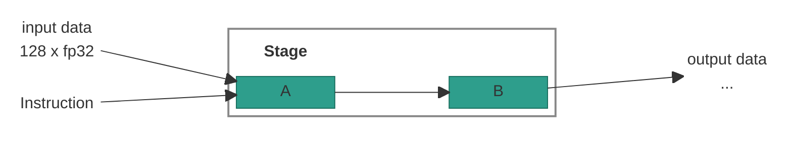

# ARCH spec skeleton

Copy this shape. `<...>` are placeholders. Keep the section numbers: readers
and cross-references rely on them. Leave out a part that has nothing to say
(for example, an instruction with no operands gets "None." under Operands).

````markdown
# <Stage Name> Stage

## 1. Overview

The <STAGE> (<expanded name>) stage performs the following tasks:

- **<Task 1>:** <one or two sentences>.
- **<Task 2>:** <one or two sentences>.

> **Note:** <one fact every reader needs before the details, if any>.

## Table of Contents

1. [Overview](#1-overview)
2. [Block Diagram](#2-block-diagram)
3. [Interfaces](#3-interfaces)
    - 3.1 [`<cr_operand>` Layout](#31-<slug>)
    - 3.2 [<Shared Concept>](#32-<slug>)
4. [<STAGE>-<Name> ISA](#4-<slug>)
    - 4.1 [`NOP`: No Operation](#41-nop-no-operation)
    - 4.2 [`<MNEMONIC>`: <Title>](#42-<slug>)
        - 4.2.1 [<Mechanism>](#421-<slug>)
    - 4.3 [`<MNEMONIC>`: <Title>](#43-<slug>)
        - 4.3.1 [<Step 1>](#431-<slug>)
        - 4.3.2 [<Step 2>](#432-<slug>)
            - 4.3.2.1 [<Detail>](#4321-<slug>)

## 2. Block Diagram



## 3. Interfaces

| Name | Direction | Description |
|------|-----------|-------------|
| input data | Input | <what, width, from which stage>. |
| Instruction | Input | The operation that the stage does on the input data. |
| output data | Output | <what, width>. |

### 3.1 `<cr_operand>` Layout

The `<cr_operand>` operand names a 32-bit `CR` that holds <what>. It has
<n> fields:

| Bits | Field | Description |
|------|-------|-------------|
| `[31:24]` | `N/A` | Not used. |
| `[23:16]` | `<field_name>` | <meaning, legal values>. |
| `[15:8]` | `<field_name>` | <meaning>. `0` = <...>, `1`-`7` = <...>. |
| `[7:0]` | `<field_name>` | <meaning>. |

`<field_name>` encoding:

| Value | Meaning |
|-------|---------|
| `0` | <meaning>. |
| `1`-`7` | <meaning>. |

### 3.2 <Shared Concept>

<A rule several instructions use, stated generally: the fields it reads, a
numbered rule list, a one- or two-line formula, an example, a drawing.>

```text
<variable> = <formula>
```

**Example:** <concrete values> -> <result>.


## 4. <STAGE>-<Name> ISA

The <STAGE> slot is resolved by CTRL and forwarded down the pipeline. <Where
operand values come from.>

The opcode enum (`<slot>_inst_opcode_t`, package `ipu_instr_pkg`) is generated
from [`instruction_spec.py`](../../../src/tools/ipu-common/src/ipu_common/instruction_spec.py)
by [`gen_codegen.py`](../../../src/tools/ipu-as-py/src/ipu_as/gen_codegen.py).

> **Note:** Each `CR0`-`CR15` and `LR0`-`LR15` register named in the
> instruction operands is **32 bits** wide.

**Instructions in this section:**

| Instruction | Purpose |
|-------------|---------|
| [`NOP`](#41-nop-no-operation) | Do nothing. |
| [`<MNEMONIC>`](#42-<slug>) | <purpose in a few words>. |

---

### 4.1 `NOP`: No Operation

No operation for the <STAGE> slot.

#### Syntax

```text
NOP
```

#### Operands

None.

#### Example

```text
NOP;;
```

---

### 4.2 `<MNEMONIC>`: <Title>

<What it does, in one to three sentences. A small table if one operand selects
between cases.>

#### Syntax

```text
<MNEMONIC> <operand_a>, <operand_b>
```

#### Operands

The Type column links to the [operand type reference](../operand-types.md).

| Name | Type | Used by | Details |
|------|------|---------|---------|
| `<operand_a>` | [`CrIdx`](../operand-types.md#cridx) | <Step> | `CR0`-`CR15`. Supplies <what> (section 3.1). |
| `<operand_b>` | `Imm` | <Step> | `0`-`4`, or enum values `off`, `on`. <meaning>. |

(Drop the "Used by" column when the instruction has a single step.)

#### Operation

```text
for i in 0..127:
    <result>[i] = <step_1>(<operand_a>, input_data[i])     // 4.2.1
<destination> = <result>                                // 4.2.2
```

#### Example

```text
<MNEMONIC> <value_a>, <value_b>;;      // <what this example does>
```

---

#### 4.2.1 <Mechanism or Step>

<One opening sentence. Then tables, formulas, edge cases. Use bold lead-ins
(**Source.**, **Payload.**, **Fields.**) for short parts that don't need a
heading.>

| <Column> | <Column> | <Column> |
|----------|----------|----------|
| ... | ... | ... |

#### <Values or Special Cases>

| Function | Input `x` | Result |
|----------|-----------|--------|
| `<name>` | <case> | <result> |

> **TBD - ask <owner>:** <the open question, precisely>.
````
