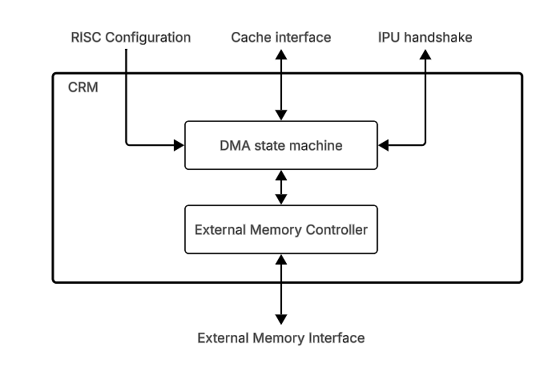

# CRM

## 1. Overview

The CRM (Cache Replacement Management) performs the following tasks:

- **Data prefetch:** Read weights/activations from memory to cache.
- **Proactive write-back:** Write activations from cache to memory.
- **Cache snooping:** Track IPU accesses to free cache banks.

**Internal structure:**

- External memory controller
- DMA state machine
- Double buffer configuration

> **Note:** Does not act like standard cache that uses fetch upon miss and
> write-back upon invalidate.

## Table of Contents

1. [Overview](#1-overview)
2. [Block Diagram](#2-block-diagram)
3. [Interfaces](#3-interfaces)
4. [Tables and Bank State](#4-tables-and-bank-state)
    - 4.1 [Table Types](#41-table-types)
    - 4.2 [Table Properties](#42-table-properties)
    - 4.3 [Bank State](#43-bank-state)
5. [CRM Operations](#5-crm-operations)

## 2. Block Diagram

## 3. Interfaces

| Name | Direction | Description |
|------|-----------|-------------|
| RISC Configuration | Input | The RISC-V writes the tables (section 4.2) and starts the CRM. |
| Cache interface | Bidirectional | Read and write interface of data to the cache. |
| IPU handshake | Bidirectional | In: the IPU address and table ID of each access. Out: publish bank state. |
| External Memory Interface | Bidirectional | Read and write interface for prefetch data and for write-back. |

## 4. Tables and Bank State

### 4.1 Table Types

- 8 tables for each configuration.
    each table has two propertys 
        external_memory_en
        snopping_en
>snooping releate to any indication form the ipu regarding relasing of banks 
- Each table handles one data flow that relates to the active kernel.
- There are several types of tables:
    - **read-only:** Reads data from external memory and stores it in the
      dedicated banks of the cache. Uses cache snooping for bank release.

        | `external_memory_en` | `snooping_en` | Description |Full residency |
        |------|------|-------------|------|
        | `0` | `0` | Data already exist there is no need to bring form memory and snooping is not needed becasue we want to keep it to the next layer. | T |
        | `0` | `1` | Data already exist and can be release there is no furher use  | T |
        | `1` | `0` | prefetch from external memory, bank release by is not needed . | T |
        | `1` | `1` | prefetch from external memory, bank release by snooping. | F |

    - **write-only:** write data form cache to extrenal memory use snooping for bank release.
   

        | `external_memory_en` | `snooping_en` | Description |Full residency |
        |------|------|-------------|------|
        | `0` | `0` | The data stays in the cache for the next layer. No write to external memory. | T |
        | `0` | `1` | Not supported  |  |
        | `1` | `0` | The data stays in the cache. A write-through also writes it to external memory(i.e. debug). | T |
        | `1` | `1` | write-back to external memory, bank release by snooping. | F |

    - **read_after_write:** a table that first act like as write-only table and them switch mid kernel to read-only

        Only these combinations are supported:

        | Write `external_memory_en` | Write `snooping_en` | Read `external_memory_en` | Read `snooping_en` | Description |Full residency |
        |------|------|------|------|-------------|------|
        | `0` | `0` | `0` | `0` | The data stays in the cache. No write to external memory. After the read, the data stays in the cache for the next layer. | T |
        | `0` | `0` | `0` | `1` | The data stays in the cache. No write to external memory. The read releases the banks by snooping. | T |
        | `1` | `0` | `0` | `0` | The data stays in the cache. A write-through also writes it to external memory(debug). After the read, the data stays in the cache for the next layer. | T |
        | `1` | `0` | `0` | `1` | The data stays in the cache. A write-through also writes it to external memory. The read releases the banks by snooping. | T |
        | `1` | `1` | `1` | `1` | Write-back to external memory, bank release by snooping. The read prefetches the data from external memory, bank release by snooping. | F |

    - **scratchpad:** The IPU uses this table for temporary data. The IPU
      writes and reads it with random access. The CRM does no prefetch,
      write-back or snooping on this table. The table must be fully in the
      cache.

        > **Note:** The CRM does not need to know about this table. We
        > configure it in the CRM for good measure.

### 4.2 Table Properties

> **TBD:** State the number of tables and how the host writes them.

| Field | Bits | Description |
|-------|------|-------------|
| `type` |  | `read-only`, `write-only`, `read-after-write`, `scratchpad`. |
| `dram_base_address` | 32 | Resolution of 1KB. |
| `table_size` | 32 | Resolution of element. |
| `xmem_bank_list[16]` | | Ordered array of banks. |
| `table_inherit_list[16]` |  | Ordered array of `table_inherit` structs, one for each bank in `xmem_bank_list`. |
| `xmem_num_of_banks` | 4 | Number of banks. |
| `external_memory_en` |  | Enables read and write to external memory: prefetch for a read and write-back. |
| `snooping_en` |  | Enables bank release from IPU indications. |
| `num_loops` |  | Number of times to read the table.|
| `jump_back` |  | The number of addresses that the IPU can go back after it reads an address. Example: `read_addr = 100` and `jump_back = 10`. The IPU cannot access addresses `0`-`90`. |

`table_inherit` struct:

| Field | Bits | Description |
|-------|------|-------------|
| `table_id` |  | The table that this table inherits the bank from. |
| `configuration` |  | The configuration that this table inherits the bank from: `self`, `previous` or `none`. |

### 4.3 Bank State

> **TBD:** Give the per-bank state that the CRM reads and writes.

| Bits | Field | Description |
|------|-------|-------------|
| TBD | TBD | TBD. |

## 5. CRM Operations

> **TBD:** State which request starts each operation.

**Operations in this section:**

| Operation | Purpose |
|-----------|---------|
| IPU Read | TBD. |
| IPU Write | TBD. |

---

