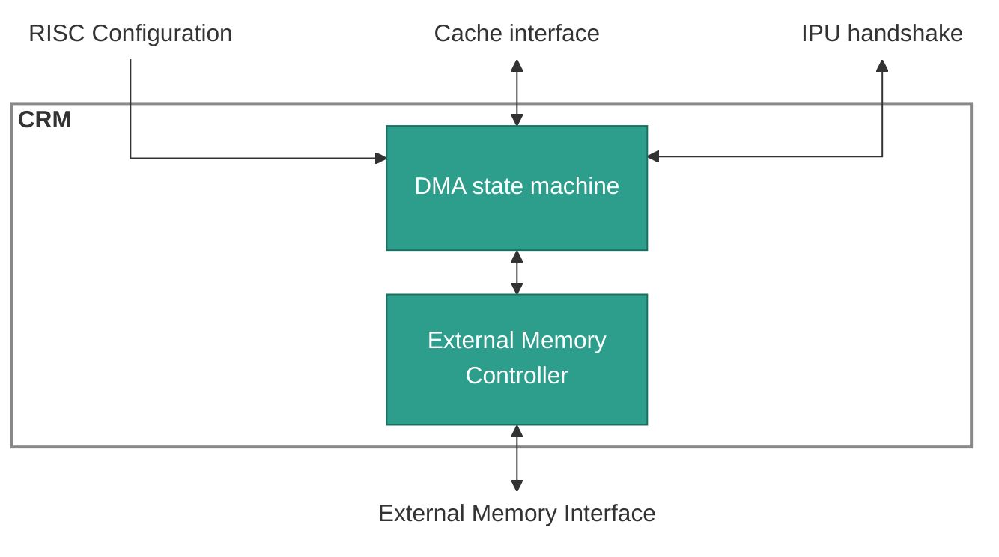

# CRM

## 1. Overview

The CRM (Cache replacment menagment) performs the following tasks:

- **Data prefetch:** Read weights/activations from memory to cache.
- **Proactive write-back:** Write activations from cache to memory.
- **Cache snooping:** Track IPU accesses to free cache banks.

**Internal structure:**

- External memory controller
- DMA state machine
- Double buffer configuration

> **Note:** Does not act like standard cache that uses fetch upon miss and
> write-back upon invalidate.

## Table of Contents

1. [Overview](#1-overview)
2. [Block Diagram](#2-block-diagram)
3. [Interfaces](#3-interfaces)
    - 3.1 [Table Layout](#31-table-layout)
    - 3.2 [Table Types](#32-table-types)
    - 3.3 [Bank State](#33-bank-state)
4. [CRM Operations](#4-crm-operations)
    - 4.1 [IPU Read](#41-ipu-read)
    - 4.2 [IPU Write](#42-ipu-write)

## 2. Block Diagram



## 3. Interfaces

| Name | Direction | Description |
|------|-----------|-------------|
| TBD | TBD | TBD. |

### 3.1 Table Layout

> **TBD:** State the number of tables and how the host writes them.

| Bits | Field | Description |
|------|-------|-------------|
| TBD | TBD | TBD. |

### 3.2 Table Types

> **TBD:** Give the behavior of each table type.

| Value | Type | Behavior |
|-------|------|----------|
| TBD | TBD | TBD. |

### 3.3 Bank State

> **TBD:** Give the per-bank state that the CRM reads and writes.

| Bits | Field | Description |
|------|-------|-------------|
| TBD | TBD | TBD. |

## 4. CRM Operations

> **TBD:** State which request starts each operation.

**Operations in this section:**

| Operation | Purpose |
|-----------|---------|
| [IPU Read](#41-ipu-read) | TBD. |
| [IPU Write](#42-ipu-write) | TBD. |

---

### 4.1 IPU Read

> **TBD:** Give what the operation does, in one to three sentences.

#### Inputs

| Name | Width | Details |
|------|-------|---------|
| TBD | TBD | TBD. |

#### Operation

```text
TBD
```

#### Example

```text
TBD
```

---

### 4.2 IPU Write

> **TBD:** Give what the operation does, in one to three sentences.

#### Inputs

| Name | Width | Details |
|------|-------|---------|
| TBD | TBD | TBD. |

#### Operation

```text
TBD
```

#### Example

```text
TBD
```
