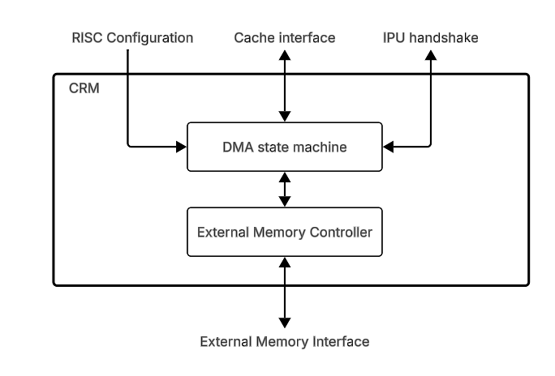

# CRM

## 1. Overview

The CRM (Cache Replacement Management) performs the following tasks:

- **Data prefetch:** Read weights/activations from memory to cache.
- **Proactive write-back:** Write activations from cache to memory.
- **Cache snooping:** Track IPU accesses to free cache banks.

**Internal structure:**

- External memory controller
- DMA state machine
- Double buffer configuration

> **Note:** Does not act like standard cache that uses fetch upon miss and
> write-back upon invalidate.

## Table of Contents

1. [Overview](#1-overview)
2. [Block Diagram](#2-block-diagram)
3. [Interfaces](#3-interfaces)
4. [Tables](#4-tables)
    - 4.1 [Table Types](#41-table-types)
    - 4.2 [Table Properties](#42-table-properties)
    - 4.3 [Bank Configuration](#43-bank-configuration)
5. [CRM Operations](#5-crm-operations)
    - 5.1 [TAG and Bank State](#51-tag-and-bank-state)
    - 5.2 [Read-Only Table](#52-read-only-table)
    - 5.3 [Write-Only Table](#53-write-only-table)
    - 5.4 [Read-After-Write Table](#54-read-after-write-table)
    - 5.5 [Scratchpad Table](#55-scratchpad-table)
    - 5.6 [Compression and Expansion](#56-compression-and-expansion)

## 2. Block Diagram



## 3. Interfaces

| Name | Direction | Description |
|------|-----------|-------------|
| RISC Configuration | Input | The RISC-V writes the tables (section 4.2) and starts the CRM. |
| Cache interface | Bidirectional | Read and write interface of data to the cache. |
| IPU handshake | Bidirectional | In: the IPU address and table ID of each access. Out: publish bank state. |
| External Memory Interface | Bidirectional | Read and write interface for prefetch data and for write-back. |

## 4. Tables

### 4.1 Table Types

- 8 tables for each configuration.
    each table has the property 
        `external_memory_en`
>snooping releate to any indication form the ipu regarding relasing of banks 
- Each table handles one data flow that relates to the active kernel.
- There are several types of tables:
    - **read-only:** Reads data from external memory and stores it in the
      dedicated banks of the cache. Uses cache snooping for bank release.

        | `external_memory_en` | Description |Full residency |
        |------|-------------|------|
        | `0` | Data already exist and can be release there is no furher use  | T |
        | `1` | prefetch from external memory, bank release by snooping. | T/F |


    - **write-only:** write data form cache to extrenal memory use snooping for bank release.
   

        | `external_memory_en` | Description |Full residency |
        |------|-------------|------|
        | `0` | Not supported  |  |
        | `1` | write-back to external memory, bank release by snooping. | T/F |


    - **read_after_write:** a table that first act like as write-only table and them switch mid kernel to read-only

        Only these combinations are supported:

        | Write `external_memory_en` | Read `external_memory_en` | Description |Full residency |
        |------|------|-------------|------|
        | `0` | `0` | The data stays in the cache. No write to external memory. The read releases the banks by snooping. | T |
        | `1` | `0` | The data stays in the cache. A write-through also writes it to external memory. The read releases the banks by snooping. | T |
        | `1` | `1` | Write-back to external memory, bank release by snooping. The read prefetches the data from external memory, bank release by snooping. | F |

    - **scratchpad:** The IPU uses this table for temporary data. The IPU
      writes and reads it with random access. The CRM does no prefetch,
      write-back or snooping on this table. The table must be fully in the
      cache.

        > **Note:** The CRM does not need to know about this table. We
        > configure it in the CRM for good measure.


### 4.2 Table Configurtion

> **TBD:** State the number of tables and how the host writes them.

| Field | Bits | Description |
|-------|------|-------------|
| `type` |  | `read-only`, `write-only`, `read-after-write`, `scratchpad`. |
| `dram_base_address` | 32 | Resolution of 1KB. |
| `table_size` |  | Resolution of 128 element. |
| `xmem_bank_list[16]` | | Ordered array of banks. |
| `table_inherit_list[16]` |  | Ordered array of table IDs, one for each bank in `xmem_bank_list`. Each table ID is the table that this table inherits the bank from, or `no_name` when the bank is not inherited. |
| `xmem_num_of_banks` | 4 | Number of banks. |
| `external_memory_en` |  | Enables read and write to external memory: prefetch for a read and write-back. |
| `num_loops` |  | Number of times to read the table.|
| `jump_back` |  | The number of addresses that the IPU can go back after it reads an address. Example: `read_addr = 100` and `jump_back = 10`. The IPU cannot access addresses `0`-`90`. `jump_back` can be `INF`: the IPU can go back to any address of the table. |
| `num_bits` | 4 | The number of bits for each element. It is the compressed format of the elements that the IPU transfers. |

### 4.3 Bank Configuration

| Field | Bits | Description |
|-------|------|-------------|
| `last_table_used` |  | The last table that uses the bank in this kernel. After this table, no table in this kernel uses the bank. |


## 5. CRM Operations

### 5.1 TAG and Bank State

```text
TAG = [table_id, virtual_address[31:10]]
```

`virtual_address` is in the context of the IPU and its per table

Each bank has this state:

| Field | Description |
|-------|-------------|
| `tag` | The TAG of the page that the bank holds. `FREE` when the bank holds no page. |
| `table_id` | The table that uses the bank. |
| `table_state` | The state of the table in `table_id` for the bank: `used` or `free`. |

The operations use these values:

```text
page_number  = virtual_address[31:10]
bank(page_number) = xmem_bank_list[page_number % xmem_num_of_banks]
```

### 5.2 Read-Only Table

#### 5.2.1 CRM Side

**Prefetch** (`external_memory_en == 1`):

The CRM does these steps for each page in that order:

1. The CRM waits until `bank(page_number).tag == FREE`.
2. The CRM reads the page from external memory.
3. The CRM writes the page into the bank.
4. After the write is complete, the CRM sets `bank(page_number).tag` to the TAG of the page.

The CRM does this sequence `num_loops` times.

**Snooping:**

The CRM keeps a snoop address for the table. The CRM uses the snoop address to release banks.
snoop_address = virtual_address - jump_back
The IPU cannot access an address below `snoop_address` again. Thus, the CRM can release these addresses.
> **Note:** The CRM releases a full bank only. Thus, the CRM releases a bank only when `snoop_address` crosses the end of that bank.

The CRM also monitors a hint from the IPU. The CRM uses this hint to release all the banks of the table.


#### 5.2.2 IPU Side

**IPU read:**

```text
if (bank(page_number).tag != TAG)
    IPU_stall
```

### 5.3 Write-Only Table

**Bank claim:**

The CRM does these steps for each `page_number` from `0` to `last_page`, in order:

1. The CRM waits until `bank(page_number).tag == FREE`.
2. The CRM sets `bank(page_number).tag` to the TAG of the page.

**IPU write:**

```text
if (bank(page_number).tag != TAG)
    IPU_stall
```

**Write-back** (`external_memory_en == 1`):

The CRM keeps `ready_page` for the table. The value starts at `0`.
The CRM does this logic for each IPU write of the table:

```text
if (ready_page < oldest_page)
    ready_page = oldest_page

if (virtual_address == last_address)
    ready_page = last_page + 1
```

The IPU does not write a page below `ready_page` again.

The CRM does these steps for each `page_number` from `0` to `last_page`, in order:

1. The CRM waits until `page_number < ready_page`.
2. The CRM reads the page from the bank.
3. The CRM writes the page to external memory.
4. After the write is complete, the CRM sets `bank(page_number).tag = FREE`.

### 5.4 Read-After-Write Table

The table first operates as a write-only table (section 5.3). The write
phase ends when the IPU writes `last_address` and the write-back is
complete. Then the table operates as a read-only table (section 5.2).

### 5.5 Scratchpad Table

The CRM does no operation on this table.

### 5.6 Compression and Expansion

In external memory, each element has `num_bits` bits. In the cache, each
element has 8 bits.

**Compression** (write-back, cache to external memory):

The CRM discards the `8 - num_bits` LSBs of each element.

```text
external_element = cache_element[7 : 8 - num_bits]
```

**Expansion** (prefetch, external memory to cache):

The CRM adds `8 - num_bits` zero bits at the LSB of each element.

```text
cache_element = {external_element, (8 - num_bits)'b0}
```


---

