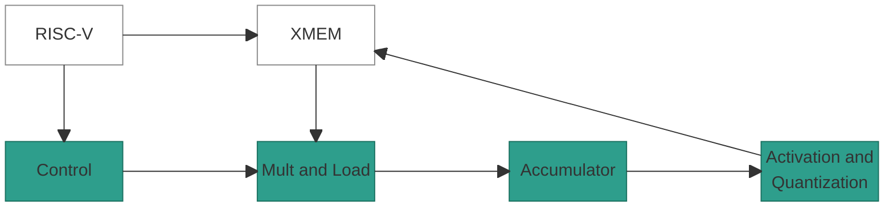
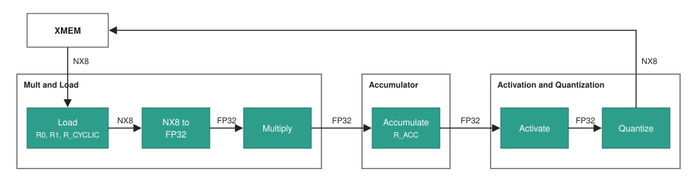
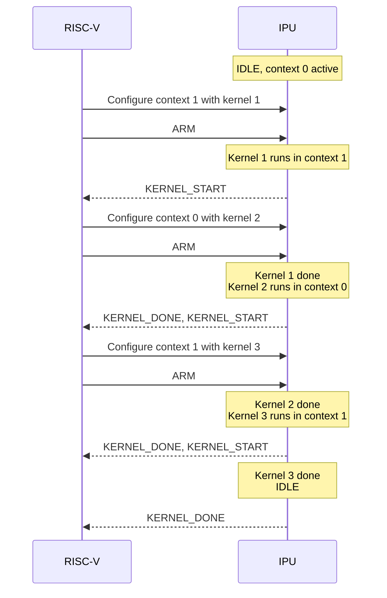

# IPU

## 1. Overview

The IPU (Inference Processing Unit) is a VLIW vector processor that runs
neural-network kernels. It performs the following tasks:

- **Control:** Runs one word per clock cycle.
- **Memory access:** Reads and writes XMEM rows.
- **Compute:** Processes one 128-element vector per word.
- **Host control:** Takes kernels, commands and debug accesses from the host.

## Table of Contents

1. [Overview](#1-overview)
2. [Block Diagram](#2-block-diagram)
3. [Interfaces](#3-interfaces)
4. [Architectural State](#4-architectural-state)
5. [Instruction Word](#5-instruction-word)
6. [Pipeline and Timing](#6-pipeline-and-timing)
    - 6.1 [Stages](#61-stages)
    - 6.2 [Execution Model](#62-execution-model)
    - 6.3 [Register Read Timing](#63-register-read-timing)
7. [Data Flow](#7-data-flow)
    - 7.1 [NX8 Element Format](#71-nx8-element-format)
    - 7.2 [Row Layout](#72-row-layout)
8. [CR Formats](#8-cr-formats)
    - 8.1 [Quantization Format (`qf`)](#81-quantization-format-qf)
    - 8.2 [Data Structure (`ds`)](#82-data-structure-ds)
    - 8.3 [Active Elements](#83-active-elements)
    - 8.4 [NX Constant](#84-nx-constant)
    - 8.5 [Signed Integer](#85-signed-integer)
9. [Memory Model](#9-memory-model)
10. [Execution Flow](#10-execution-flow)
11. [Faults and Arithmetic Events](#11-faults-and-arithmetic-events)
12. [Host Control and Debug](#12-host-control-and-debug)
13. [Parameters](#13-parameters)
14. [Disagreements with the Emulator](#14-disagreements-with-the-emulator)

## 2. Block Diagram



| Block | Role | Defined in |
|-------|------|------------|
| RISC-V | The host. Loads kernels, and controls and debugs the IPU. | Section 12 |
| XMEM | The IPU's external memory. | [Cache Unit Specification](cache-unit.md) |
| Control | Holds the PC, the IMEM banks, the CR banks and the LR file. Fetches words, resolves branches and operand values, and executes the LR slots. | Sections 5 and 6 |
| Mult and Load | Loads XMEM rows and multiplies vectors. | [MULT Stage ARCH](ARCH-stage-mult.md) |
| Accumulator | Combines the multiply result into `R_ACC`. | [ACC Stage ARCH](ARCH-stage-acc.md) |
| Activation and Quantization | Activates and quantizes a vector, and writes it to XMEM. | [AaQ Stage ARCH](ARCH-stage-aaq-str.md) |

## 3. Interfaces

| Interface | Peer | Description |
|-----------|------|-------------|
| Host | RISC-V | Kernel load, commands, status and debug, and one interrupt line. |
| Load | XMEM | One row per word (section 7.2). |
| Store | XMEM | One row per word (section 7.2). |

> **Note:** The IPU has one clock and one reset.

## 4. Architectural State

| State | Size | Owner | Host access |
|-------|------|-------|-------------|
| PC | `log2(IMEM_BANK_DEPTH)` bits | Control | Read. Write in `HALTED`. |
| IMEM | 2 banks of `IMEM_BANK_DEPTH` words | Control | Write while the context is unlocked. |
| `CR0`-`CR15` | 2 banks of 16 registers of 32 bits | Control | Read. Write while the context is unlocked. |
| `LR0`-`LR15` | 16 registers of 32 bits | Control | Read |
| `R0`, `R1` | 128 elements of 8 bits, each with a metadata word | Mult and Load | None |
| `R_CYCLIC` | 512 elements of 8 bits, with a metadata word per 128-element slot | Mult and Load | None |
| `R_MASK` | 8 slots of 128 bits | Mult and Load | None |
| `R_ACC` | 128 elements of 32 bits | Accumulator | None |
| LUT | 256 entries of 17 bits and a 46-bit metadata block | Activation and Quantization | None |

> **Note:** `CR0` reads as `0` and `CR1` reads as `1` in both banks.

## 5. Instruction Word

A hardware word is 169 bits, with six slot types:

| Slot | Count | Stage | Instructions |
|------|-------|-------|--------------|
| `COND` | 1 | Control | `BEQ`, `BNE`, `BLT.S`, `BGE.S`, `BR`, `HALT` |
| `LR` | 3 | Control | `SET`, `ADD`, `SUB`, `INC.MODP2`, `INC`, `DEC`, `ADDB`, `ADDBI` |
| `LOAD` | 1 | Mult and Load | `LD.MULT`, `LD.MULT.CYCLIC`, `LD.MASK` |
| `MULT` | 1 | Mult and Load | `MULT.RC.VV`, `MULT.RC.VE`, `MULT.RC.VS`, `MULT.VE`, `MULT.EE` |
| `ACC` | 1 | Accumulator | `ACC.ADD`, `ACC.SUB`, `ACC.MAX`, `ACC.STRIDE`, `AGG.SUM`, `AGG.MAX`, `ACC.RESHAPE` and their `.FIRST` variants |
| `AAQ` | 1 | Activation and Quantization | `LD.LUT`, `ACTIVATE.QUANTIZE` |

[`instruction_spec.py`](../../../src/ipu-isa/src/ipu_isa/instruction_spec.py) is
the source of the opcodes and the fields.

**Word rules.**

- `LD.LUT` and a `LD.*` of the `LOAD` slot cannot share a word.
- Control resolves every CR and LR operand.
- `HALT` is the last word of a kernel. The other slots of that word execute.

## 6. Pipeline and Timing

### 6.1 Stages

One word moves through four stages, in this order: Control, Mult and Load,
Accumulator, Activation and Quantization.

The IPU starts one word per clock cycle. Control stalls on an XMEM miss. A stall
changes no result.

### 6.2 Execution Model

Each word executes atomically. The state after a word equals the state from
executing its slots in this order: `COND` and `LR`, `LOAD`, `MULT`, `ACC`,
`AAQ`.

### 6.3 Register Read Timing

A cycle here is the execution of one word.

| Reader | Register | Value read |
|--------|----------|------------|
| `COND`, `LR` | `LR`, `CR` | Start of the cycle. |
| `LOAD`, `MULT`, `ACC`, `AAQ` | `LR` operands | End of the cycle. |
| `MULT` | `R0`, `R1`, `R_CYCLIC`, `R_MASK` and their metadata | Start of the cycle. |
| `ACC` | `MULT_RES` | End of the cycle. |
| `AAQ` | `R_ACC` | End of the cycle. |

## 7. Data Flow



| Point | Format | Size |
|-------|--------|------|
| XMEM row | NX8 | 128 elements of 8 bits and a metadata word |
| `R0`, `R1`, `R_CYCLIC` | NX8 | Section 4 |
| Multiply result | FP32 | 128 elements |
| `R_ACC` | FP32 | 128 elements |
| Activated elements | FP32 | 128 elements |
| Stored row | NX8 | 128 elements of 8 bits and a metadata word |

The Mult and Load stage converts each NX8 element to FP32 (section 7.1). The
Activation and Quantization stage quantizes each activated element to NX8
([AaQ Stage ARCH](ARCH-stage-aaq-str.md), section 4.3.2).

### 7.1 NX8 Element Format

An element is 8 bits, packed from the MSB as `{S?, Exp, M, 0-pad}`:

| Field | Width | Present when |
|-------|-------|--------------|
| `S` | 1 bit | `sign = 1` |
| `Exp` | `fe` bits | Always |
| `M` | `fm = W - fe - sign` bits | Always |
| `0-pad` | The rest of the 8 bits | `W < 8` |

**Value.** With the block scale `s` (8-bit `e8m0`):

```text
Emax = 2^fe - 1

if sign = 1 and Exp = Emax and M = 0:                     // NaN code
    fp32 = NaN
else if Exp < Emax:                                       // direct
    fp32 = (-1)^S x 2^(s - 127 - Exp) x (1 + M / 2^fm)
else:                                                     // clamp
    fp32 = (-1)^S x 2^(s - 127 - (Emax - 1)) x (M / 2^fm)
```

**Special values.** `NaN` is `-0`, so it exists only in a signed format:

| Value | `S` | `Exp` | `M` |
|-------|-----|-------|-----|
| `0` | `0` | `2^fe - 1` | `0` |
| `NaN` (`-0`) | `1` | `2^fe - 1` | `0` |
| `inf` | `0` | `0` | `2^fm - 1` |
| `-inf` | `1` | `0` | `2^fm - 1` |

For example, the `NaN` code of signed `e4m3` is `0xF8`.

> **TBD - ask Jacob:** is the largest magnitude the right NX8 code for `inf` and
> `-inf`? With this code, the value above reads back finite. For comparison, two
> 8-bit floating-point formats:
>
> | Format | `inf` | Largest finite value | Notes |
> |--------|-------|----------------------|-------|
> | `e5m2` | Yes: `inf`, `-inf` and `NaN` | `±57,344` | A value cast beyond the maximum becomes `inf` or `-inf`. Used for gradients and intermediate ranges that need a wider dynamic range. |
> | `e4m3` | No | `±448` | The codes that IEEE formats give to `inf` hold more finite numbers, for higher precision up to the maximum. |

### 7.2 Row Layout

| Field | Size | Position |
|-------|------|----------|
| Elements | 128 x 8 bits | Element `i` is byte `i` of the row. |
| `scale` | 8 bits | Metadata bits `[7:0]`. Scale shared by the whole vector. |
| `dynamic_exponent` | 1 bit | Metadata bit `[8]`. `e1` or `e2`: the exponent width chosen in dynamic quantization. `0` in static quantization. |

Metadata bits `[15:9]` are not used.

## 8. CR Formats

These formats apply to every stage that reads them.

### 8.1 Quantization Format (`qf`)

The `qf` operand names a 16-bit half of a `CR`: `CRn.L` (bits `[15:0]`) or
`CRn.H` (bits `[31:16]`).

| Bits | Field | Description |
|------|-------|-------------|
| `[15:12]` | `dynamic` | `0` = static, `1` = dynamic. |
| `[11:8]` | `sign` | `0` = unsigned, `1` = signed. |
| `[7:4]` | `exp_format` | Exponent width `fe` of a static format: `1`-`7` = `e1`-`e7`. `fe + sign` is at most `num_bits`. |
| `[3:0]` | `num_bits` | Total element width `W`: `1`-`8`. |

**Exponent width `fe`:**

| `dynamic` | `fe` |
|-----------|------|
| `0` | The `exp_format` value. |
| `1` | `1` if `dynamic_exponent = 0`, `2` if `dynamic_exponent = 1`. |

A dynamic format allows any `sign` and any `num_bits >= 2 + sign`.

### 8.2 Data Structure (`ds`)

The `ds` operand names a 16-bit half of a `CR` (`CRn.L` or `CRn.H`).

| Bits | Field | Description |
|------|-------|-------------|
| `[15:12]` | `valid_partitions` | Number of valid groups: `1`-`num_partitions`. The rightmost `num_partitions - valid_partitions` groups are masked. |
| `[11:10]` | `mask_type` | The value the Mult and Load stage writes into masked elements. |
| `[9:8]` | `num_partitions` | Number of groups, coded `0`-`3` = `1`, `2`, `4`, `8`. One group is one line of 128 elements, two groups are two lines of 64 elements. |
| `[7:0]` | `valid_elements` | Number of valid elements in a group: `0`-`128 / num_partitions`. |

| `mask_type` | Pad value |
|-------------|-----------|
| `0` | `0` |
| `1` | `+inf` |
| `2` | `-inf` |
| `3` | `NaN` |

### 8.3 Active Elements

The 128 elements are split into `num_partitions` equal groups:

1. Only the first `valid_partitions` groups are active.
2. In each active group, only the first `valid_elements` elements are active.

```text
group_size = 128 / num_partitions
active[i] = (i / group_size < valid_partitions) and (i % group_size < valid_elements)
```

**Example:** `num_partitions = 4`, `valid_partitions = 3`, `valid_elements = 10`.
Each group has 32 elements, so active elements are `0-9`, `32-41` and `64-73`
(30 elements). Group 3 (`96-127`) is masked.


### 8.4 NX Constant

A `CR` that holds an NX-type floating-point value:

| Bits | Field | Description |
|------|-------|-------------|
| `[31:24]` | `N/A` | Not used. |
| `[23:20]` | `sign` | `0` = unsigned, `1` = signed. |
| `[19:16]` | `exp_format` | Exponent width `fe`: `1`-`7` = `e1`-`e7`. `fe + sign` is at most 8. |
| `[15:8]` | `scale` | The scale of `value`, `e8m0`. |
| `[7:0]` | `value` | The NX8 element (section 7.1): 8 bits wide, static. |

The constant converts to FP32 as in section 7.1, with `num_bits = 8`. `CR0` is
the constant `0.0` and `CR1` is the constant `1.0`.

### 8.5 Signed Integer

A `CR` that holds an integer is 32 bits in two's complement. An `LR` or `COND`
operand that names a half (`CRn.L` or `CRn.H`) reads it sign-extended.

## 9. Memory Model

Every XMEM access names a base `CR` and an offset `LR`:

```text
row_address = CR[base] + LR[offset]
```

| Field | Bits | Meaning |
|-------|------|---------|
| `table_id` | 4 | Table that holds the array. |
| `offset` | 20 | Row in the table. |

## 10. Execution Flow

The IPU has two contexts. Each one holds an IMEM bank, a CR bank and a table
set. The host loads a kernel into the inactive context.

| Run state | Meaning |
|-----------|---------|
| `IDLE` | No kernel runs. |
| `RUNNING_UNARMED` | A kernel runs. No kernel is armed. |
| `RUNNING_ARMED` | A kernel runs. The kernel in the inactive context starts when it is done. |
| `HALTED` | The kernel stands at a word boundary. |

Reset enters `IDLE` in context 0 with PC `0`.

**Example: three kernels.** Configure means writing the IMEM bank, the CR bank
and the table set of the inactive context.



[Execution flow](../requirements/execution-flow.md) defines the commands and the
state transitions.

> **TBD - ask Aviv:** after the `HALT` instruction retires, does the kernel end
> (the IPU goes to `IDLE`, or the armed kernel starts), or does the IPU enter
> `HALTED` ([OQ-31](../requirements/open-questions.md))?

## 11. Faults and Arithmetic Events

A fault is an illegal state. The faulting word and all younger words have no
architectural effect, and all older words retire. An enabled fault enters
`HALTED`, and a disabled fault sets a sticky flag.

Accumulator overflow, `NaN` results and quantization saturation are arithmetic
events. They never halt.

[Faults](../requirements/faults.md) lists the faults and events.

## 12. Host Control and Debug

The host loads kernels, issues commands and reads status through registers. An
illegal host access returns an error and never disturbs a running kernel.

[Host registers](../requirements/host-registers.md) lists the registers, and
[Debug](../requirements/debug.md) defines halt, step, breakpoints and register
read-out.

## 13. Parameters

| Name | Value | Description |
|------|-------|-------------|
| `NUM_ELEMENTS` | `128` | Elements in a vector. |
| `WORD_WIDTH` | `169` | Bits in a hardware word. |
| `REG_WIDTH` | `32` | Bits in a `CR` or an `LR`. |
| `IMEM_BANKS` | `2` | IMEM banks. |
| `IMEM_BANK_DEPTH` | `1024` | Words per IMEM bank. |
| `CR_BANKS` | `2` | CR banks. |
| `ROW_BYTES` | `128` | Element bytes in a row. |

> **TBD:** `IMEM_BANK_DEPTH` is the proposal of
> [OQ-4](../requirements/open-questions.md).

## 14. Disagreements with the Emulator

The emulator's `BREAK` and `AAQ_EXACT` slots and its FP32 mode are emulator-only.

| Topic | Spec | Emulator |
|-------|------|----------|
| Contexts and run states | Section 10. | One program until `HALT`, with no contexts, run states or host registers. |
| XMEM miss | Control stalls. | No stall model. |
| Dynamic format | Section 8.1. | Only `sign = 1` and `num_bits = 8`. |
| `NaN` in NX8 | Section 7.1. | No `NaN` code. |

The stage-level differences are in
[AaQ Stage ARCH](ARCH-stage-aaq-str.md), section 5.
