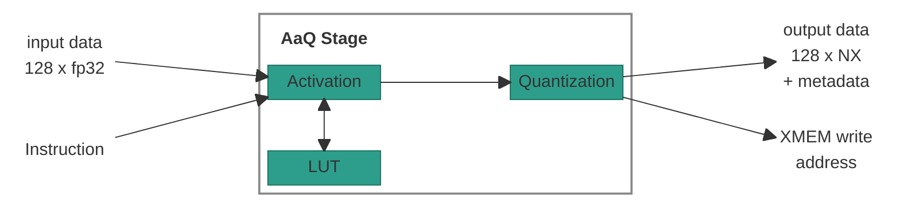
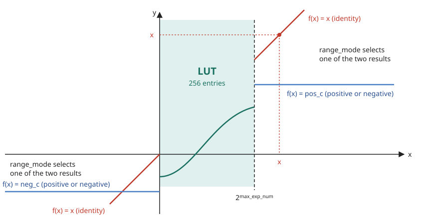
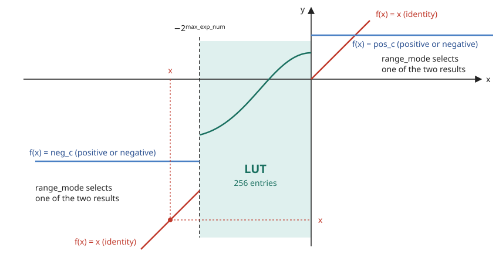
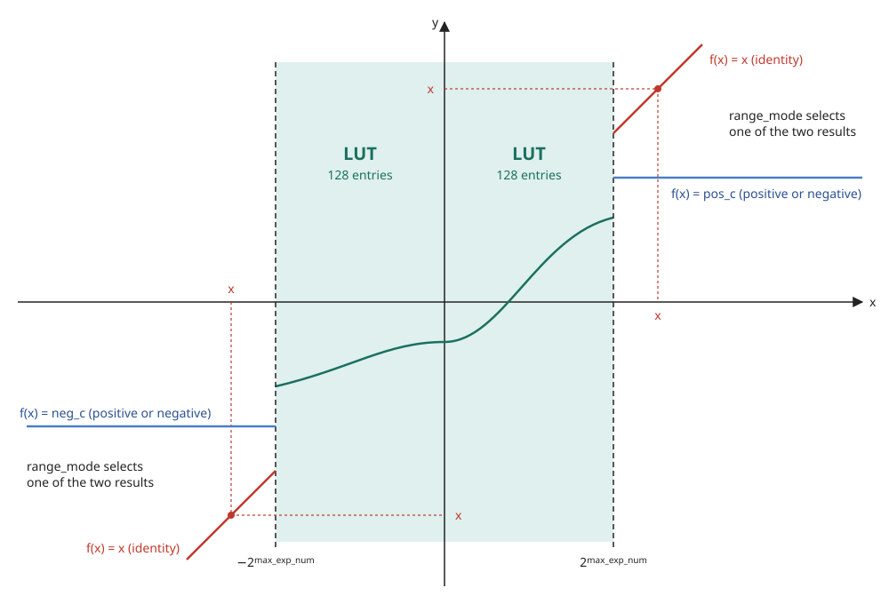

# AaQ Stage

## 1. Overview

The AaQ (Activation and Quantization) stage perfome the following tasks:

- **Activation:** The stage applies activation functions and special functions
  to each element of the fp32 vector. ReLU and GeLU are examples of the
  activation functions.
- **Quantization:** The stage changes each fp32 element into the NX8 format.
  The quantization method is fixed or dynamic.
- **Store:** After the quantization, the stage writes the result to XMEM.

> **Note:** A configurable lookup table (LUT) implements some of the activation
> functions and special functions.

## Table of Contents

1. [Overview](#1-overview)
2. [Block Diagram](#2-block-diagram)
3. [Interfaces](#3-interfaces)
4. [AaQ-Str ISA](#4-aaq-str-isa)
    - 4.1 [`NOP`: No Operation](#41-nop-no-operation)
    - 4.2 [`LD.LUT`: Load Function Estimation LUT Segment](#42-ldlut-load-function-estimation-lut-segment)
        - 4.2.1 [Function Estimation LUT](#421-function-estimation-lut)
        - 4.2.2 [Metadata Block](#422-metadata-block)
        - 4.2.3 [LUT Addressing](#423-lut-addressing)
    - 4.3 [`ACTIVATE.QUANTIZE`: Activate and Quantize](#43-activatequantize-activate-and-quantize)
        - 4.3.1 [Activate](#431-activate)
        - 4.3.2 [Quantize](#432-quantize)
            - 4.3.2.1 [Block Scale and Exponent Distance](#4321-block-scale-and-exponent-distance)
            - 4.3.2.2 [Exponent and Mantissa Encoding](#4322-exponent-and-mantissa-encoding)
            - 4.3.2.3 [Dynamic Exponent Selection](#4323-dynamic-exponent-selection-fe-1-or-fe-2)
        - 4.3.3 [Store](#433-store)
5. [Disagreements with the Emulator](#5-disagreements-with-the-emulator)

## 2. Block Diagram



## 3. Interfaces

| Name | Direction | Description |
|------|-----------|-------------|
| input data | Input | The 128-element fp32 vector from the ACC stage. |
| Instruction | Input | The operation that the stage does on the input data. |
| output data | Output | One XMEM row: the 128-element NX vector and its metadata ([IPU ARCH 7.2](ARCH-ipu-top.md#72-row-layout)). |
| XMEM write address | Output | The XMEM address to which the stage writes the output data. |

[IPU ARCH 8](ARCH-ipu-top.md#8-cr-formats) defines `qf`, `ds` and the active elements.

## 4. AaQ-Str ISA

The AaQ slot is resolved by CTRL and forwarded down the pipeline. The stage
does not read the CR/LR register files itself (see the Control Stage spec,
section 5).

The opcode enum (`aaq_inst_opcode_t`, package `ipu_instr_pkg`) is generated
from [`instruction_spec.py`](../../../src/ipu-isa/src/ipu_isa/instruction_spec.py)
by [`sv_package.py`](../../../src/ipu-gen/src/ipu_gen/sv_package.py).

**Instructions in this section:**

| Instruction | Purpose |
|-------------|---------|
| [`NOP`](#41-nop-no-operation) | Do nothing. |
| [`LD.LUT`](#42-ldlut-load-function-estimation-lut-segment) | Fill the function estimation LUT. |
| [`ACTIVATE.QUANTIZE`](#43-activatequantize-activate-and-quantize) | Activate, quantize and store. |

---

### 4.1 `NOP`: No Operation

No operation for the AaQ slot.

#### Syntax

```text
NOP
```

#### Operands

None.

#### Example

```text
NOP;;
```

---

### 4.2 `LD.LUT`: Load Function Estimation LUT Segment

`LD.LUT` fills one **segment** (1024 bits) of the function estimation LUT
(section 4.2.1). The data comes from the lower 32 words of `input data`.

`lut_addr` selects which segment is written:

| `lut_addr` | What it loads |
|------------|---------------|
| `0`-`3` | One 1024-bit slice of the table. |
| `4` | The last 256 bits of the table, plus the metadata block (section 4.2.2). |

#### Syntax

```text
LD.LUT lut_addr table_id table_offset
```

#### Operands

| Name | Type | Details |
|------|------|---------|
| `lut_addr` | `Imm` | `0`-`4`. LUT segment index: `0`-`3` = table slices, `4` = last table bits + metadata. |
| `table_id` | [`CrIdx`](../reference/isa/operand-types.md#cridx) | `CR0`-`CR15`. Base row in XMEM. The CTRL stage resolves it. |
| `table_offset` | [`LrIdx`](../reference/isa/operand-types.md#lridx) | `LR0`-`LR15`. Row offset in XMEM. The CTRL stage resolves it. |

#### Operation

```text
payload[1023:0] = {input_data[31], ..., input_data[0]}     // 32 words x 32 bits

if lut_addr <= 3:                                          // full table slice
    TABLE_BITS[1024*lut_addr +: 1024] = payload

else if lut_addr == 4:                                     // last table bits + metadata
    TABLE_BITS[4351:4096] = payload[255:0]
    {pos_mode, neg_mode, range_mode, pos_c, neg_c, max_exp_num} = payload[301:256]
    // field layout in section 4.2.2
```

#### Example

```text
LD.LUT 4 CR13 LR0;;      // load the metadata block
```

> **Note:** The AaQ-Str stage gets only the data, on `input data`. It drives no
> XMEM write address for `LD.LUT`.

---

#### 4.2.1 Function Estimation LUT

The stage holds one function estimation LUT. It has two parts:

| Part | Size | Purpose |
|------|------|---------|
| Table | 256 entries x 17 bits = **4,352 bits** | The function values. |
| Metadata block | **46 bits** | Configures range handling. |

**Entry format.** A table entry, `neg_c` and `pos_c` each have 1 sign bit, 8
exponent bits and 8 mantissa bits: `{S, e, M}`. The fp32 result is
`{S, e, M, 15'b0}`.

Both parts are filled by `LD.LUT`, one segment per instruction. The 3-bit
`lut_addr` selects the segment. Five `LD.LUT` instructions (`lut_addr`
`0`-`4`) program the whole LUT.

#### 4.2.2 Metadata Block

**Where it lives.** The metadata is in bits `[301:256]` of the `lut_addr = 4`
payload.

**Fields.**

| Local bits | Name | Meaning |
|------------|------|---------|
| `[7:0]` | `max_exp_num` | The **biased** FP32 exponent of the LUT range: `max_exp_num = range_exp + 127`. `exp >= max_exp_num` flags the element as out-of-range. |
| `[24:8]` | `neg_c` | 17-bit constant substituted for negative out-of-range elements. |
| `[41:25]` | `pos_c` | 17-bit constant substituted for positive out-of-range elements. |
| `[43:42]` | `range_mode` | LUT domain. See the `range_mode` table. |
| `[44]` | `neg_mode` | Result for negative out-of-range elements: `0` = `x` (identity), `1` = `neg_c`. |
| `[45]` | `pos_mode` | Result for positive out-of-range elements: `0` = `x` (identity), `1` = `pos_c`. |

**`range_mode`.**

| Value | Domain | LUT entries | LUT range |
|-------|---------|-------------|-----------|
| `0` | Positive | 256 entries for positive `x`. | `0 <= x < 2^range_exp` |
| `1` | Negative | 256 entries for negative `x`. | `-2^range_exp < x <= 0` |
| `2` | Symmetric | 128 entries for negative `x` and 128 entries for positive `x`. | `-2^range_exp < x < 2^range_exp` |

#### 4.2.3 LUT Addressing

The LUT entries are at linear intervals in the LUT range, with
`step = 2^range_exp / 256`:

| Domain | Interval | Entry points |
|---------|----------|--------------|
| Positive | `step` | `0, step, 2*step, ..., 2^range_exp - step` |
| Negative | `step` | `0, -step, -2*step, ..., -(2^range_exp - step)` |
| Symmetric | `2*step` | `-(2^range_exp - 2*step), ..., -2*step, -0` and `+0, 2*step, ..., 2^range_exp - 2*step` |

The Symmetric domain has 128 entries for each side, so the interval is `2*step`.

The Symmetric domain has two entries at zero: `-0` is the last negative entry
and `+0` is the first positive entry.

In the Positive and Negative domains, `-0` and `+0` both take LUT entry 0.

> **TBD - ask Aviv and Jacob:** do `-0` in the Positive domain and `+0` in the
> Negative domain take LUT entry 0, or does the sign bit send them to `neg_mode`
> and `pos_mode`?

**Example, Positive domain.** `max_exp_num = 129`, so `range_exp = 2` and the LUT
range is `0` to `2^range_exp = 4`.
`step = 4/256`. The entry points are:

```text
0, 4/256, 8/256, ..., 4 - 4/256
```

**Example, Symmetric domain.** `max_exp_num = 128`, so `range_exp = 1` and the LUT
range is `-2` to `2^range_exp = 2`.
`step = 2/256`. The interval is `2*step = 4/256`. The entry points are:

```text
-2 + 4/256, ..., -4/256, -0, +0, 4/256, ..., 2 - 4/256
```

**Entry selection.** `LUT(x)` returns the entry nearest to `x`, on the side of
`x`, at distance `RTN(|x| / interval) * interval` from zero (`RTN`: section
4.3.2.2). All 128 elements read the LUT at once.

> **TBD - ask Jacob or Aviv:** what is the bit position of each entry in
> `TABLE_BITS`, and in which order does the Symmetric domain hold its two sides?

> **TBD - ask Jacob or Aviv:** when `RTN(|x| / interval)` passes the last entry
> (`x` just below `2^range_exp`), does `x` take the last entry, or follow
> `pos_mode` and `neg_mode`?

---

### 4.3 `ACTIVATE.QUANTIZE`: Activate and Quantize

Activation, quantization and store happen in a single instruction.

The instruction works in three steps:

| Step | What happens | Section |
|------|--------------|---------|
| 1. Activate | Applies an element-wise activation function to every element of `input data`. | 4.3.1 |
| 2. Quantize | Converts each activated fp32 element into the NX8 format. | 4.3.2 |
| 3. Store | Writes the result to XMEM. | 4.3.3 |

#### Syntax

```text
ACTIVATE.QUANTIZE activation_fn ds qf table_id table_offset
```

#### Operands

| Name | Type | Used by | Details |
|------|------|---------|---------|
| `activation_fn` | [`Imm`](../reference/isa/operand-types.md#activationfn) | Activate | Enum that names the activation (see [`activation_fn` Values](#activation_fn-values)). |
| `ds` | [`HalfCrIdx`](../reference/isa/operand-types.md#halfcridx) | Quantize | `CR0.L`-`CR15.H`. Supplies the data structure of the 128-element vector: `valid_partitions`, `num_partitions`, `valid_elements` ([IPU ARCH 8.2](ARCH-ipu-top.md#82-data-structure-ds)). |
| `qf` | [`HalfCrIdx`](../reference/isa/operand-types.md#halfcridx) | Quantize | `CR0.L`-`CR15.H`. Supplies the quantization format ([IPU ARCH 8.1](ARCH-ipu-top.md#81-quantization-format-qf)). |
| `table_id` | [`CrIdx`](../reference/isa/operand-types.md#cridx) | Store | `CR0`-`CR15`. Base row in XMEM. The CTRL stage resolves it. |
| `table_offset` | [`LrIdx`](../reference/isa/operand-types.md#lridx) | Store | `LR0`-`LR15`. Row offset in XMEM. The CTRL stage resolves it. |

#### Operation

```text
for i in 0..127:
    activated[i] = activate(activation_fn, input_data[i])   // 4.3.1: all elements

for i in 0..127:                                            // active[i]: IPU ARCH 8.3
    if active[i]:
        aaq_out.elements[i] = quantize(activated[i])        // 4.3.2
    else:
        aaq_out.elements[i] = sign ? NaN : 0                // 4.3.2

aaq_out.scale            = scale                        // section 4.3.2.1
aaq_out.dynamic_exponent = dynamic ? (fe == 2) : 0            // section 4.3.2.3
XMEM[table_id + table_offset] = aaq_out                 // 4.3.3: store
```

#### Example

```text
ACTIVATE.QUANTIZE relu CR15.L CR15.H CR13 LR0;;
```

---

#### 4.3.1 Activate

Applies the function named by `activation_fn` to every element of
`input data`.

| Computed | `activation_fn` |
|----------|-----------------|
| Directly | `identity`, `relu`, `relu6` |
| Through the LUT | `reciprocal`, `rsqrt`, `exp2`, `generic` |

There is a LUT, loaded by `LD.LUT` (section 4.2). For the LUT-based
functions, load the matching function before `ACTIVATE.QUANTIZE`.

#### `activation_fn` Values

| Encoding | Name | Formula | Computed by |
|----------|------|---------|-------------|
| 0 | `identity` | `f(x) = x` | Direct |
| 1 | `relu` | `f(x) = max(0, x)` | Direct |
| 2 | `relu6` | `f(x) = min(max(0, x), 6)` | Direct |
| 3 | `reciprocal` | `f(x) = 1/x` | LUT + dedicated logic |
| 4 | `rsqrt` | `f(x) = 1/√x` | LUT + dedicated logic |
| 5 | `exp2` | `f(x) = 2^x` | LUT + dedicated logic |
| 6 | `generic` | `f(x) = Generic(x)` | LUT + dedicated logic |

> **TBD - ask Jacob or Aviv:** do the metadata block (section 4.2.2) and the LUT
> addressing (section 4.2.3) apply to `reciprocal`, `rsqrt` and `exp2`, or only
> to `generic`? What is the dedicated logic of each function?

#### Special Cases

`epsilon = 2^-127`.

| Function | Input `x` | Result |
|----------|-----------|--------|
| `reciprocal` | `0` | `inf` |
| `reciprocal` | `-0` | `-inf` |
| `reciprocal` | positive subnormal | `f(x) = 1/(x + epsilon)` |
| `reciprocal` | negative subnormal | `f(x) = 1/(x - epsilon)` |
| `reciprocal` | `inf` or `-inf` | `0` |
| `rsqrt` | `0` | `inf` |
| `rsqrt` | `-0` | `-inf` |
| `rsqrt` | positive subnormal | `f(x) = 1/sqrt(x + epsilon)` |
| `rsqrt` | `inf` | `0` |
| `rsqrt` | negative | `NaN` |
| `exp2` | `-inf` | `0` |
| `exp2` | positive | Undefined: the input must be non-positive. |
| Every function | `NaN` | `NaN` |

#### The `generic` Function: LUT Domains

The LUT for `generic` has three domains. `range_mode` selects the domain.
The drawings that follow are a reference for each domain.

> **Note:** `pos_c` is the constant for the positive side of the x axis.
> `neg_c` is the constant for the negative side of the x axis. The value of each
> constant can be positive or negative.

##### Positive Domain (`range_mode = 0`)

All 256 LUT entries are for positive `x`. Out of the LUT range, `pos_mode`
and `neg_mode` select the result: `x` (identity) or a constant.

$$
f(x) =
\begin{cases}
\mathrm{LUT}(x) & 0 \le x < 2^{\mathrm{max\_exp\_num}} \\
x \ \text{or} \ \mathrm{pos\_c} & x \ge 2^{\mathrm{max\_exp\_num}} \\
x \ \text{or} \ \mathrm{neg\_c} & x < 0
\end{cases}
$$



##### Negative Domain (`range_mode = 1`)

All 256 LUT entries are for negative `x`. Out of the LUT range, `pos_mode`
and `neg_mode` select the result: `x` (identity) or a constant.

$$
f(x) =
\begin{cases}
\mathrm{LUT}(x) & -2^{\mathrm{max\_exp\_num}} < x \le 0 \\
x \ \text{or} \ \mathrm{neg\_c} & x \le -2^{\mathrm{max\_exp\_num}} \\
x \ \text{or} \ \mathrm{pos\_c} & x > 0
\end{cases}
$$



##### Symmetric Domain (`range_mode = 2`)

The LUT entries are divided into 128 entries for negative `x` and 128 entries
for positive `x`. Out of the LUT range, `pos_mode` and `neg_mode` select the
result: `x` (identity) or a constant.

$$
f(x) =
\begin{cases}
\mathrm{LUT}(x) & -2^{\mathrm{max\_exp\_num}} < x < 2^{\mathrm{max\_exp\_num}} \\
x \ \text{or} \ \mathrm{pos\_c} & x \ge 2^{\mathrm{max\_exp\_num}} \\
x \ \text{or} \ \mathrm{neg\_c} & x \le -2^{\mathrm{max\_exp\_num}}
\end{cases}
$$



---

#### 4.3.2 Quantize

Converts each activated fp32 element (IEEE-754 single precision: sign `S`,
8-bit exponent `e`, 23-bit mantissa) into the NX8 format set by the
quantization format `qf` ([IPU ARCH 8.1](ARCH-ipu-top.md#81-quantization-format-qf)).

**Outputs:**

| Output | Description |
|--------|-------------|
| Elements | One 8-bit element per input element. |
| `scale` | One 8-bit scale shared by the whole block. |
| `dynamic_exponent` | `e1` or `e2`: the exponent width chosen in dynamic quantization. |

**Element format.** Each element is NX8 ([IPU ARCH 7.1](ARCH-ipu-top.md#71-nx8-element-format)). `S` is the input sign, passed
through. A finite element that rounds to `-0` gets `S = 0`.

These elements take a special value directly, without section 4.3.2.2:

| Element | Signed format | Unsigned format |
|---------|---------------|-----------------|
| Not active | `NaN` | `0` |
| `NaN` | `NaN` | `0` |
| `inf` | `inf` | `inf` |
| `-inf` | `-inf` | `0` |

> **TBD - ask Aviv:** an unsigned format has no `NaN` code. Is `0` the right
> value for an element that is not active, `NaN` or `-inf`?

> **TBD - ask Jacob or Aviv:** how does an unsigned format encode a negative
> finite element: `0`, or its magnitude `|x|`?

#### 4.3.2.1 Block Scale and Exponent Distance

**Scale.** `scale` is an 8-bit `e8m0` value (exponent only). It is the largest raw
exponent among the active elements:

```text
scale = max(e[i] for i in 0..127 if active[i] and not is_inf[i] and not is_nan[i])
    // is_inf: inf or -inf; is_nan: NaN
```

> **Note:** An activated fp32 element that is `inf`, `-inf` or `NaN` is left out
> of the scale.

> **Note:** `scale = 0` when no element qualifies.

> **Note:** A negative element in an unsigned format counts toward `scale` and
> the sums of section 4.3.2.3.

**Exponent distance.** Each element is encoded by its distance from the scale:

```text
E = scale - e
```

`E >= 0` for every active finite element. `E = 0` at the element(s) with the
block maximum, and `E` grows as the element gets smaller relative to that
maximum.

#### 4.3.2.2 Exponent and Mantissa Encoding

`RTN` is round to nearest. An exact half rounds **up** (away from zero in
magnitude): `0.5 -> 1`, `1.5 -> 2`, `2.5 -> 3`.

| Branch | Condition | `Exp` | `M` |
|--------|-----------|-------|-----|
| Direct | `0 <= E < 2^fe - 1` | `E` | `RTN(1.M)` rounded to `fm` bits |
| Clamp | `E >= 2^fe - 1` | `2^fe - 1` (saturated) | `RTN(1.M >> [E - (2^fe - 1) + 1])` |

In the clamp branch the extra right-shift keeps the element's magnitude.

> **TBD - ask Jacob or Aviv:** what does an element equal to zero (`e = 0`)
> write? Both branches assume a hidden leading 1, so an all-zero block reads
> back as `2^-127`. Is it the `0` code, or does the hidden 1 stay?

> **TBD - ask Jacob or Aviv:** what does a subnormal element write: the same as
> zero, `1.M` with the hidden 1, or `0.M`?

**Rounding carry.** When `RTN` carries out of the `fm` bits (`M == 2^fm`), the
result is corrected:

| Branch | Corrected result | Reason |
|--------|------------------|--------|
| Direct, `E > 0` | `Exp = E - 1`, `M = 0` | `1.11...1` rounded up to `10.00...0`: the value moved one binade up. |
| Direct, `E = 0` | `Exp = 0`, `M = 2^fm - 1` | There is no binade above the scale, so the element saturates at the largest value. |
| Clamp | `Exp = 2^fe - 2`, `M = 0` | `0.11...1` rounded up to `1.00...0`: the smallest directly-encoded value. |

#### 4.3.2.3 Dynamic Exponent Selection (`fe = 1` or `fe = 2`)

Applies when `dynamic = 1` ([IPU ARCH 8.1](ARCH-ipu-top.md#81-quantization-format-qf)). A smaller `W` takes fewer mantissa bits,
and `sign = 0` gives one more:

| `sign` | `num_bits` | `dynamic_exponent = 0` | `dynamic_exponent = 1` |
|--------|------------|------------------------|------------------------|
| `1` | `8` | `e1m6` | `e2m5` |
| `0` | `8` | `e1m7` | `e2m6` |
| `1` | `6` | `e1m4` | `e2m3` |

| Split | Exponent bits | Mantissa bits | Encodable `E` | Step at `E`, relative to the block scale |
|---|---|---|---|---|
| `fe1` | 1 | `fm1` | 0, 1 | `2^(-E - fm1)`, clamped at `E >= 1` |
| `fe2` | 2 | `fm1 - 1` | 0, 1, 2, 3 | `2^(-E - fm1 + 1)`, clamped at `E >= 3` |

- `fe1` is one bit finer near the top of the block.
- `fe2` reaches two binades further down before it clamps.

The rule uses `fm1` only in the two multipliers, so it holds for any `W` and
`sign_bit`.

##### Definitions

- `fm1 = W - 1 - sign_bit`: the mantissa bits under `fe1`.
- `err1`: the element's truncation error under `fe1`.
- `err2`: the element's truncation error under `fe2`.
- `err1` and `err2` are per block: both are in units of `2^(scale - 127)`.

##### Element classification

| Condition | Sum | Meaning |
|---|---|---|
| `E = 0` | A | `fe1` is finer here. A measures the cost of choosing `fe2`. |
| `E = 1` | none | Don't care. |
| `1 < E <= fm1 + 2` | B | `fe2` is finer here. B measures the cost of choosing `fe1`. |
| `E > fm1 + 2` | none | Out of range for both splits. |
| Not active, `NaN`, `inf` or `-inf` | none | Left out of both sums. |

##### Per-element terms

```text
A = RTN( |err2^2 - err1^2| * 2^(2*fm1) )
B = RTN( |err2^2 - err1^2| * 2^(2*(fm1 + 1)) )
```

##### Decision

```text
if sum(B) - 4 * sum(A) < 0:  choose fe1        // dynamic_exponent = 0
else:                        choose fe2        // dynamic_exponent = 1
```

The B multiplier `2^(2*(fm1 + 1))` is four times the A multiplier `2^(2*fm1)`.
Multiplying `sum(A)` by 4 puts both sums in the same units.

##### Both estimators are unbiased

Assume the mantissa bits are uniformly distributed. Then `r`, the finer split's
error as a fraction of its own step, is uniform on `[0, 1)`, and the dropped bit
is 1 with probability one half.

| Term | Pre-RTN value | Distribution | Outcomes | E[RTN] | E[pre-RTN] |
|---|---|---|---|---|---|
| A | `1 + 2r` | uniform on `[1, 3)` | 1, 2, 3 at 0.25, 0.5, 0.25 | 2 | 2 |
| B | `(1 + 2r) / 4` | uniform on `[0.25, 0.75)` | 0, 1 at 0.5, 0.5 | 0.5 | 0.5 |

Including the zero case, `E[A] = 1` and `E[B] = 0.25`. Rounding adds noise to
the sums, with no drift toward either format as the block grows.

##### Worked example

A block of ten values, with `scale = 127` and `fm1 = 4` (signed, `W = 6`):

- A multiplier: `2^8 = 256`.
- B multiplier: `2^10 = 1024`.

| # | v | e | E | Sum | err1 | err2 | \|err2^2 - err1^2\| | Pre-RTN | A | B |
|---|---|---|---|---|---|---|---|---|---|---|
| 1 | 1.83 | 127 | 0 | A | 0.0175 | 0.0800 | 6.09375e-3 | 1.560 | 2 | |
| 2 | 1.21 | 127 | 0 | A | 0.0225 | 0.0850 | 6.71875e-3 | 1.720 | 2 | |
| 3 | 1.57 | 127 | 0 | A | 0.0075 | 0.0700 | 4.84375e-3 | 1.240 | 1 | |
| 4 | 0.94 | 126 | 1 | none | don't care | don't care | | | | |
| 5 | 0.67 | 126 | 1 | none | don't care | don't care | | | | |
| 6 | 0.41 | 125 | 2 | B | 0.00375 | 0.00375 | 0 | 0 | | 0 |
| 7 | 0.2345 | 124 | 3 | B | 0.01575 | 0.000125 | 2.48047e-4 | 0.254 | | 0 |
| 8 | 0.1780 | 124 | 3 | B | 0.02175 | 0.006125 | 4.35547e-4 | 0.446 | | 0 |
| 9 | 0.0920 | 123 | 4 | B | 0.02950 | 0.013875 | 6.77734e-4 | 0.694 | | 1 |
| 10 | 0.0555 | 122 | 5 | B | 0.02425 | 0.008625 | 5.13672e-4 | 0.526 | | 1 |

**Result:** `sum(A) = 5`, `sum(B) = 2`, and `2 - 4 * 5 = -18`. The result is
negative, so the block selects **`fe1`**.

---

#### 4.3.3 Store

Writes the quantized result, on `output data`, to XMEM row
`table_id + table_offset`.

[IPU ARCH 7.2](ARCH-ipu-top.md#72-row-layout) defines the row layout.

> **Note:** The AaQ-Str stage gets the XMEM write address explicitly.

## 5. Disagreements with the Emulator

| Topic | Spec | Emulator |
|-------|------|----------|
| Element that is not active | `NaN` in a signed format, `0` in an unsigned format. | `0` in both. |
| Active `NaN` | `NaN` in a signed format, `0` in an unsigned format. | Emulator error. |
| Finite element that rounds to `-0` | `S = 0`. | Keeps the input sign, so `S = 1`. |
| `reciprocal` and `rsqrt` of `0` and `-0` | `inf`, or `-inf` for `-0`. | Follows the subnormal rows: `reciprocal` gives `2^127` or `-2^127`, and `rsqrt` gives `2^63.5`. |
| LUT evaluation | The LUT implements the activation functions. | Stores the LUT bits and evaluates with exact math. |
| Dynamic format | Any `sign` and any `num_bits >= 2 + sign`. | Only `sign = 1` and `num_bits = 8`. Other values are a configuration error. |
| LUT load source | `input_data[31:0]`. | The first 128 bytes of the XMEM row at `table_id + table_offset`. |
