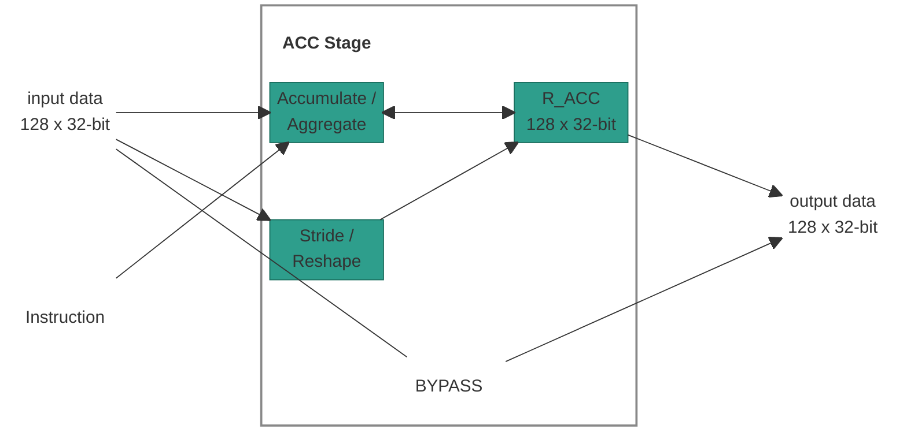
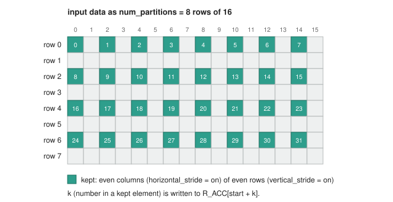
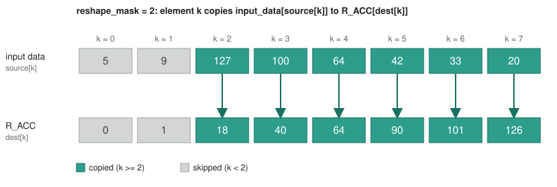

# Accumulator Stage

## 1. Overview

The ACC (Accumulator) stage owns `R_ACC`, a 128-element register of 32-bit
elements, and combines each cycle's multiply result into it. It performs the
following tasks:

- **Accumulate:** Sets `R_ACC` to the multiply result, or adds, subtracts or
  takes the maximum of the multiply result and `R_ACC`, element by element.
- **Stride:** Reshapes the multiply result with a predetermined pattern (every
  second column and/or row) into a range of `R_ACC`.
- **Aggregate:** Reduces the valid elements of the multiply result to one
  value (sum or maximum) and writes it into one `R_ACC` element.
- **Reshape:** Copies up to 8 elements of the multiply result to `R_ACC`. The
  source and destination of each element are arbitrary.
- **Bypass:** Sends the multiply result to the output. `R_ACC` keeps its value.

> **Note:** `R_ACC` is the stage's output to the AaQ stage every cycle, except
> in a `BYPASS` cycle.

## Table of Contents

1. [Overview](#1-overview)
2. [Block Diagram](#2-block-diagram)
3. [Interfaces](#3-interfaces)
    - 3.1 [`dstructure` Layout](#31-dstructure-layout)
    - 3.2 [Element Format](#32-element-format)
    - 3.3 [Running and `.FIRST` Variants](#33-running-and-first-variants)
4. [Accumulator ISA](#4-accumulator-isa)
    - 4.1 [`NOP`: No Operation](#41-nop-no-operation)
    - 4.2 [`ACC.SET`, `ACC.ADD`, `ACC.SUB`, `ACC.MAX`: Element-wise Accumulate](#42-accset-accadd-accsub-accmax-element-wise-accumulate)
    - 4.3 [`ACC.STRIDE`: Accumulator Stride](#43-accstride-accumulator-stride)
    - 4.4 [`AGG.SUM`, `AGG.MAX`: Aggregate](#44-aggsum-aggmax-aggregate)
    - 4.5 [`ACC.RESHAPE`: Reshape](#45-accreshape-reshape)
    - 4.6 [`BYPASS`: Bypass](#46-bypass-bypass)

## 2. Block Diagram



## 3. Interfaces

| Name | Direction | Description |
|------|-----------|-------------|
| input data | Input | The multiply result from the MULT stage: 128 elements of 32 bits. |
| Instruction | Input | The operation that the stage does on the input data. |
| output data | Output | `R_ACC`, or `input data`: 128 elements of 32 bits, to the AaQ stage. |

### 3.1 `dstructure` Layout

The `cr_idx` operand of `ACC.STRIDE`, `AGG.SUM` and `AGG.MAX` names a 32-bit
`CR` that holds the data structure format of the 128-element vector. It has
four 8-bit fields:

| Bits | Field | Description |
|------|-------|-------------|
| `[31:24]` | `N/A` | Not used. |
| `[23:16]` | `valid_partition` | Number of valid groups. The rightmost `num_partition - valid_partition` groups are masked. |
| `[15:8]` | `num_partition` | Number of groups: `1`, `2`, `4` or `8`. `1` means one line of 128 elements, `2` means two lines of 64 elements. |
| `[7:0]` | `valid_elements` | Number of valid elements in a group. |

### 3.2 Element Format

Each `R_ACC` element is an FP32 value (IEEE-754 single precision), the same as
each element of `input data`. It can be `inf` or `-inf`.

### 3.3 Running and `.FIRST` Variants

`AGG.SUM` and `AGG.MAX` each have a `.FIRST` variant:

| Variant | Uses the current `R_ACC` value | Purpose |
|---------|--------------------------------|---------|
| Running (`AGG.SUM`) | Yes | Accumulate across cycles. |
| `.FIRST` (`AGG.SUM.FIRST`) | No: the result depends on `input data` only | Start a new operation. |

## 4. Accumulator ISA

The ACC slot is resolved by CTRL and forwarded down the pipeline. The stage
does not read the CR/LR register files itself (see the Control Stage spec,
section 5).

The opcode enum (`acc_inst_opcode_t`, package `ipu_instr_pkg`) is generated
from [`instruction_spec.py`](../../../src/tools/ipu-common/src/ipu_common/instruction_spec.py)
by [`gen_codegen.py`](../../../src/tools/ipu-as-py/src/ipu_as/gen_codegen.py).

> **Note:** Each `CR0`-`CR15` and `LR0`-`LR15` register named in the
> instruction operands is **32 bits** wide. An `LRD` operand (a pair of LRs)
> comes with its value, as a `CR` operand does.

**Instructions in this section:**

| Instruction | Purpose |
|-------------|---------|
| [`NOP`](#41-nop-no-operation) | Do nothing. |
| [`ACC.SET`, `ACC.ADD`, `ACC.SUB`, `ACC.MAX`](#42-accset-accadd-accsub-accmax-element-wise-accumulate) | Set `R_ACC` to `input data`, or combine them, element by element. |
| [`ACC.STRIDE`](#43-accstride-accumulator-stride) | Reshape `input data` into a range of `R_ACC` with a predetermined pattern. |
| [`AGG.SUM`, `AGG.MAX`](#44-aggsum-aggmax-aggregate) | Reduce `input data` to one `R_ACC` element. |
| [`ACC.RESHAPE`](#45-accreshape-reshape) | Copy chosen `input data` elements to chosen `R_ACC` elements. |
| [`BYPASS`](#46-bypass-bypass) | Send `input data` to `output data`. |

---

### 4.1 `NOP`: No Operation

No operation for the ACC slot. `R_ACC` keeps its value.

#### Syntax

```text
NOP
```

#### Operands

None.

#### Example

```text
NOP;;
```

---

### 4.2 `ACC.SET`, `ACC.ADD`, `ACC.SUB`, `ACC.MAX`: Element-wise Accumulate

Sets each element of `R_ACC` to the same element of `input data`, or combines
them. All 128 elements are written.

#### Syntax

```text
ACC.SET
ACC.ADD
ACC.SUB
ACC.MAX
```

#### Operands

None.

#### Operation

For each element `i` in `0..127`:

| Mnemonic | `R_ACC[i]` becomes |
|----------|--------------------|
| `ACC.SET` | `input_data[i]` |
| `ACC.ADD` | `R_ACC[i] + input_data[i]` |
| `ACC.SUB` | `R_ACC[i] - input_data[i]` |
| `ACC.MAX` | `input_data[i]` if `input_data[i] > R_ACC[i]`, else `R_ACC[i]` |

**Special cases.** `param1` is `R_ACC[i]` and `param2` is `input_data[i]`. `x`
is any value that is not NaN. `f` is a finite value. `±inf` is `inf` or `-inf`.

| Mnemonic | Case | Result |
|----------|------|--------|
| `ACC.ADD`, `ACC.SUB`, `ACC.MAX` | `param1` or `param2` is NaN | NaN |
| `ACC.ADD` | One parameter is `inf`, the other is `-inf` | NaN |
| `ACC.SUB` | `param1` and `param2` are the same infinity | NaN |
| `ACC.ADD` | One parameter is `±inf`, the other is `f` or the same infinity | That infinity |
| `ACC.SUB` | `param1` is `±inf`, `param2` is `f` or the opposite infinity | `param1` |
| `ACC.SUB` | `param1` is `f`, `param2` is `±inf` | `-param2` |
| `ACC.MAX` | One parameter is `inf`, the other is `x` | `inf` |
| `ACC.MAX` | One parameter is `-inf`, the other is `x` | `x` |

#### Example

```text
ACC.SET;;            // first partial product of a dot product
ACC.ADD;;            // add the next ones
```

---

### 4.3 `ACC.STRIDE`: Accumulator Stride

A reshape with a predetermined pattern. It views `input data` as rows, keeps
every second column and/or every second row, and writes the kept elements, row
by row, into a range of `R_ACC`. The other `R_ACC` elements keep their values.

#### Syntax

```text
ACC.STRIDE cr_idx, horizontal_stride, vertical_stride, offset
```

#### Operands

| Name | Type | Details |
|------|------|---------|
| `dstructure` | [`CrIdx`](../reference/isa/operand-types.md#cridx) | `CR0`-`CR15`. Supplies `num_partition` (section 3.1): the number of rows of `input data`. |
| `horizontal_stride` | [`Imm`](../reference/isa/operand-types.md#horizontalstride) | `off`, `on` or `on_inv`. Column pattern. |
| `vertical_stride` | [`Imm`](../reference/isa/operand-types.md#verticalstride) | `off`, `on` or `on_inv`. Row pattern. |
| `offset` | `Imm` | `0`, `16`, `32`, `48`, `64`, `80`, `96` or `112`. The first written `R_ACC` element. |

**Pattern modes:**

| Mode | Columns kept (`horizontal_stride`) | Rows kept (`vertical_stride`) |
|------|------------------------------------|-------------------------------|
| `off` | all | all |
| `on` | even: `0, 2, 4, ...` | even: `0, 2, 4, ...` |
| `on_inv` | odd: `1, 3, 5, ...` | odd: `1, 3, 5, ...` |

#### Operation

```text
rows = num_partition
elements_in_row = 128 / num_partition
view input_data as [rows][elements_in_row]          // row r = input_data[r*elements_in_row ...]
keep the columns selected by horizontal_stride
keep the rows selected by vertical_stride
kept = the kept elements, row by row                  // N elements

R_ACC[offset + k] = kept[k]   for k in 0..N-1
```

The number of written elements is:

| `horizontal_stride` | `vertical_stride` | `N` (`num_partition` = `2`, `4`, `8`) | `N` (`num_partition` = `1`) |
|---------------------|-------------------|-----|-----|
| `off` | `off` | 128 | 128 |
| `on` / `on_inv` | `off` | 64 | 64 |
| `off` | `on` / `on_inv` | 64 | 128 |
| `on` / `on_inv` | `on` / `on_inv` | 32 | 64 |

`offset + N` is at most 128.

**Example:** `num_partition = 8`, `horizontal_stride = on`,
`vertical_stride = on`, `offset = 0`. `input data` is 8 rows of 16. The
even columns of rows 0, 2, 4 and 6 are kept: 32 elements, written to
`R_ACC[0..31]`.



> **Note:** When a data structure has fewer than 8 elements, the hardware pads
> it to 16.

#### Example

```text
ACC.STRIDE CR3, on, on, 0;;
```

---

### 4.4 `AGG.SUM`, `AGG.MAX`: Aggregate

Reduces the first `valid_elements` elements of `input data` to one value and
writes it into one `R_ACC` element. The other `R_ACC` elements keep their
values.

#### Syntax

```text
AGG.SUM dest_slot, cr_idx
AGG.SUM.FIRST dest_slot, cr_idx
AGG.MAX dest_slot, cr_idx
AGG.MAX.FIRST dest_slot, cr_idx
```

#### Operands

| Name | Type | Details |
|------|------|---------|
| `dest_slot` | [`LrIdx`](../reference/isa/operand-types.md#lridx) | `LR0`-`LR15`. selects the written element. |
| `dstrcture` | [`CrIdx`](../reference/isa/operand-types.md#cridx) | `CR0`-`CR15`. Supplies `valid_elements` (section 3.1). |

#### Operation

```text
n    = min(valid_elements, 128)
```

| Mnemonic | `R_ACC[dest_slot]` becomes |
|----------|-----------------------|
| `AGG.SUM` | `R_ACC[dest_slot] + sum(input_data[0..n-1])` |
| `AGG.SUM.FIRST` | `sum(input_data[0..n-1])` |
| `AGG.MAX` | `max(R_ACC[dest_slot], input_data[0..n-1])` |
| `AGG.MAX.FIRST` | `max(input_data[0..n-1])` |

**Special cases.** `AGG.SUM` and `AGG.SUM.FIRST` follow the `ACC.ADD` special
cases. `AGG.MAX` and `AGG.MAX.FIRST` follow the `ACC.MAX` special cases
(section 4.2).

#### Example

```text
AGG.SUM.FIRST LR0, CR3;;      // R_ACC[LR0 % 128] = sum of the first valid_elements elements
```

---

### 4.5 `ACC.RESHAPE`: Reshape

A reshape with an arbitrary pattern: each element goes from any source index
to any destination index. It copies up to 8 elements of `input data` to
`R_ACC`. Two `LRD` register pairs hold the element indices: one list of 8
source indices and one list of 8 destination indices. The other `R_ACC`
elements keep their values.

#### Syntax

```text
ACC.RESHAPE source, dest, number_idx
```

#### Operands

| Name | Type | Details |
|------|------|---------|
| `source` | `LrdIdx` | `LRD0`, `LRD2`, ..., `LRD14`. 8 byte indices `source[0..7]` into `input data`. |
| `dest` | `LrdIdx` | `LRD0`, `LRD2`, ..., `LRD14`. 8 byte indices `dest[0..7]` into `R_ACC`. |
| `number_idx` | `LrIdx` / `Imm` | An immediate `0`-`7`, or `LR0`-`LR15` whose value is `0`-`8`. Elements `0..number_idx - 1` take part. |

**`number_idx` values.** `number_idx` is the number of copied elements.
Elements `k = 0..number_idx - 1` are copied:

| `number_idx` | Copied `k` | Skipped `k` |
|--------------|------------|-------------|
| `0` | none | `0`-`7` |
| `1` | `0` | `1`-`7` |
| `2` | `0`-`1` | `2`-`7` |
| `3` | `0`-`2` | `3`-`7` |
| `4` | `0`-`3` | `4`-`7` |
| `5` | `0`-`4` | `5`-`7` |
| `6` | `0`-`5` | `6`-`7` |
| `7` | `0`-`6` | `7` |

**`LRD` layout.** `LRDn` is the 64-bit pair `{LR(n+1), LR(n)}`. It holds 8
indices of 1 byte. Index `0` is in byte `0` of `LR(n)`:

| Byte | Register byte | Index |
|------|---------------|-------|
| `7` | `LR(n+1)` byte `3` | `[7]` |
| `6` | `LR(n+1)` byte `2` | `[6]` |
| `5` | `LR(n+1)` byte `1` | `[5]` |
| `4` | `LR(n+1)` byte `0` | `[4]` |
| `3` | `LR(n)` byte `3` | `[3]` |
| `2` | `LR(n)` byte `2` | `[2]` |
| `1` | `LR(n)` byte `1` | `[1]` |
| `0` | `LR(n)` byte `0` | `[0]` |

Every participating `source[k]` and `dest[k]` is `0`-`127`.

#### Operation

```text
for k in 0..number_idx-1:                   // ascending k
    R_ACC[dest[k]] = input_data[source[k]]
```

When two `dest[k]` are equal, the higher `k` wins.

**Example:** `number_idx = 6`, `source = 5, 9, 127, 100, 64, 42, 33, 20`,
`dest = 0, 1, 18, 40, 64, 90, 101, 126`. Elements `k = 0..5` are copied, for
example `R_ACC[0] = input_data[5]` and `R_ACC[18] = input_data[127]`.
Elements `k = 6, 7` are skipped. The figure has one column per `k`.



#### Example

```text
ACC.RESHAPE LRD0, LRD2, 6;;      // copy elements 0-5 of the index lists
```

---

### 4.6 `BYPASS`: Bypass

Sends `input data` to `output data`. `R_ACC` keeps its value.

#### Syntax

```text
BYPASS
```

#### Operands

None.

#### Operation

```text
for i in 0..127:
    output_data[i] = input_data[i]
```

#### Example

```text
BYPASS;;      // send the multiply result to the AaQ stage
```
