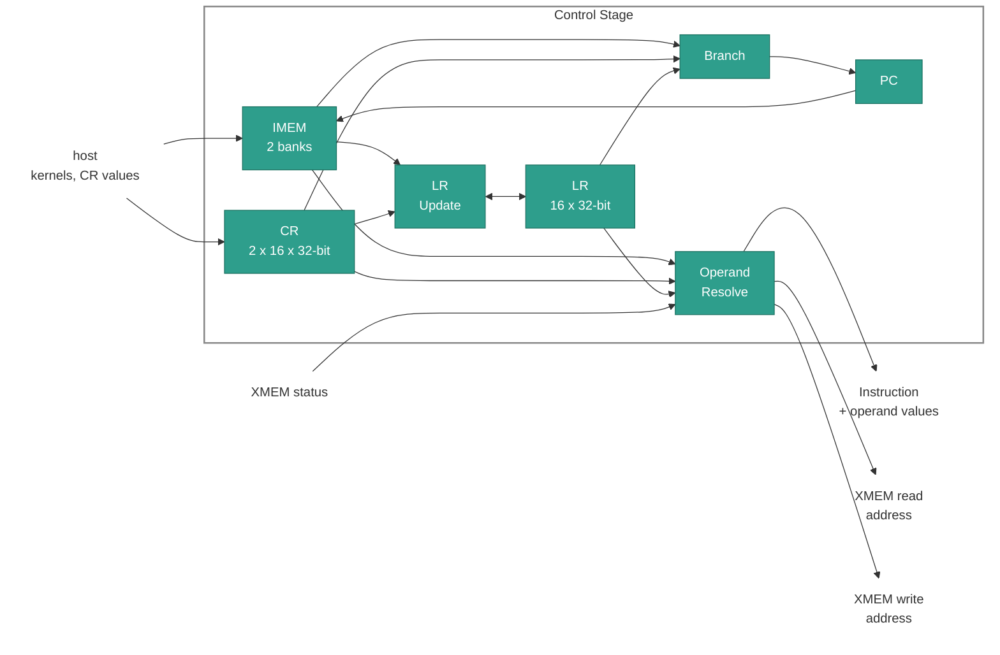

# Control Stage

## 1. Overview

The CTRL (Control) stage is the first stage of the IPU. It performs the
following tasks:

- **Fetch:** Fetches one word per clock cycle from the active IMEM bank.
- **Branch:** Executes the `COND` slot and updates the PC.
- **Loop registers:** Executes the three `LR` slots.
- **Operands:** Resolves the `CR` and `LR` operands of the later stages.
- **XMEM address:** Computes the row address of each load and store.
- **Stall:** Stalls on an XMEM miss.

## Table of Contents

1. [Overview](#1-overview)
2. [Block Diagram](#2-block-diagram)
3. [Interfaces](#3-interfaces)
    - 3.1 [Fetch](#31-fetch)
    - 3.2 [Operand Resolution](#32-operand-resolution)
    - 3.3 [XMEM Address](#33-xmem-address)
    - 3.4 [Stalls and Faults](#34-stalls-and-faults)
4. [Control ISA](#4-control-isa)
    - 4.1 [`NOP`: No Operation](#41-nop-no-operation)
    - 4.2 [`SET`: Set Loop Register](#42-set-set-loop-register)
    - 4.3 [`ADD`, `SUB`: Add and Subtract](#43-add-sub-add-and-subtract)
    - 4.4 [`INC`, `DEC`: Increment and Decrement](#44-inc-dec-increment-and-decrement)
    - 4.5 [`INC.MODP2`: Increment Modulo a Power of Two](#45-incmodp2-increment-modulo-a-power-of-two)
    - 4.6 [`ADDB`, `ADDBI`: Add Byte, Broadcast](#46-addb-addbi-add-byte-broadcast)
    - 4.7 [`BEQ`, `BNE`, `BLT.S`, `BGE.S`: Conditional Branch](#47-beq-bne-blts-bges-conditional-branch)
    - 4.8 [`BR`: Branch Register](#48-br-branch-register)
    - 4.9 [`HALT`: End the Kernel](#49-halt-end-the-kernel)

## 2. Block Diagram



## 3. Interfaces

| Name | Direction | Description |
|------|-----------|-------------|
| Host | Input | Kernels and `CR` values ([IPU ARCH 12](ARCH-ipu-top.md#12-host-control-and-debug)). |
| XMEM status | Input | Whether the XMEM rows of a word are ready. |
| Instruction | Output | The `LOAD`, `MULT`, `ACC` and `AAQ` slots of a word and their operand values, to the later stages. |
| XMEM read address | Output | The row that a load reads, to XMEM. |
| XMEM write address | Output | The row that a store writes, to the AaQ stage. |

### 3.1 Fetch

The stage fetches the word at the PC from the IMEM bank of the active context.
The `COND` slot of that word sets the next PC. A taken branch costs no extra
cycle.

### 3.2 Operand Resolution

The stage reads every `CR` and `LR` operand of the `LOAD`, `MULT`, `ACC` and
`AAQ` slots and sends the values with the slot. The later stages do not read the
`CR` and `LR` files. [IPU ARCH 6.3](ARCH-ipu-top.md#63-register-read-timing) gives
the value of each read.

### 3.3 XMEM Address

The stage computes the row address of each XMEM access
([IPU ARCH 9](ARCH-ipu-top.md#9-memory-model)):

| Instruction | Access | Base `CR` | Offset `LR` |
|-------------|--------|-----------|-------------|
| `LD.MULT`, `LD.MULT.CYCLIC`, `LD.MASK` | Read | `base` | `offset` |
| `LD.LUT` | Read | `table_id` | `table_offset` |
| `ACTIVATE.QUANTIZE` | Write | `table_id` | `table_offset` |

### 3.4 Stalls and Faults

**Stall.** The stage stalls a word until its XMEM rows are ready. A stalled word
changes no state: its `LR` writes and its PC update take effect when it moves on.

**Faults.** The stage detects every fault before the word takes effect
([Faults](../requirements/faults.md)).

## 4. Control ISA

The stage executes the `COND` slot and the three `LR` slots of each word.

The opcode enums (`cond_inst_opcode_t` and `lr_inst_opcode_t`, package
`ipu_instr_pkg`) are generated from
[`instruction_spec.py`](../../../src/ipu-isa/src/ipu_isa/instruction_spec.py)
by [`sv_package.py`](../../../src/ipu-gen/src/ipu_gen/sv_package.py).

> **Note:** Two `LR` slots of one word cannot write the same `LR`: this is fault
> F-3.

**Instructions in this section:**

| Instruction | Slot | Purpose |
|-------------|------|---------|
| [`NOP`](#41-nop-no-operation) | `LR`, `COND` | Do nothing. |
| [`SET`](#42-set-set-loop-register) | `LR` | Copy a value into an `LR`. |
| [`ADD`, `SUB`](#43-add-sub-add-and-subtract) | `LR` | Add or subtract two registers. |
| [`INC`, `DEC`](#44-inc-dec-increment-and-decrement) | `LR` | Add an immediate to an `LR`, or subtract it. |
| [`INC.MODP2`](#45-incmodp2-increment-modulo-a-power-of-two) | `LR` | Add to an `LR` modulo a power of two. |
| [`ADDB`, `ADDBI`](#46-addb-addbi-add-byte-broadcast) | `LR` | Add a byte to all 8 bytes of an `LRD`. |
| [`BEQ`, `BNE`, `BLT.S`, `BGE.S`](#47-beq-bne-blts-bges-conditional-branch) | `COND` | Branch on a comparison. |
| [`BR`](#48-br-branch-register) | `COND` | Branch to the address in a register. |
| [`HALT`](#49-halt-end-the-kernel) | `COND` | End the kernel. |

---

### 4.1 `NOP`: No Operation

No operation for the slot. In the `COND` slot, the PC moves to `PC + 1`.

#### Syntax

```text
NOP
```

#### Operands

None.

#### Example

```text
NOP;;
```

---

### 4.2 `SET`: Set Loop Register

Copies a value into an `LR`.

#### Syntax

```text
SET reg src
```

#### Operands

| Name | Type | Details |
|------|------|---------|
| `reg` | [`LrIdx`](../reference/isa/operand-types.md#lridx) | `LR0`-`LR15`. The destination. |
| `src` | [`LcrHalfIdx`](../reference/isa/operand-types.md#lcrhalfidx) | `LR0`-`LR15`, `CR0`-`CR15` or `CR0.L`-`CR15.H`. The source. A half is sign-extended ([IPU ARCH 8.5](ARCH-ipu-top.md#85-signed-integer)). |

#### Operation

```text
reg = src
```

#### Example

```text
SET LR0 CR1;;
SET LR1 CR5.H;;
```

---

### 4.3 `ADD`, `SUB`: Add and Subtract

Adds or subtracts two registers. The result wraps at 32 bits.

#### Syntax

```text
ADD dest src_a src_b
SUB dest src_a src_b
```

#### Operands

| Name | Type | Details |
|------|------|---------|
| `dest` | [`LrIdx`](../reference/isa/operand-types.md#lridx) | `LR0`-`LR15`. The destination. |
| `src_a` | [`LrIdx`](../reference/isa/operand-types.md#lridx) | `LR0`-`LR15`. The first source. |
| `src_b` | [`LcrHalfIdx`](../reference/isa/operand-types.md#lcrhalfidx) | `LR0`-`LR15`, `CR0`-`CR15` or `CR0.L`-`CR15.H`. The second source. A half is sign-extended. |

#### Operation

| Mnemonic | `dest` becomes |
|----------|----------------|
| `ADD` | `(src_a + src_b)[31:0]` |
| `SUB` | `(src_a - src_b)[31:0]` |

#### Example

```text
ADD LR0 LR1 LR2;;
SUB LR3 LR1 CR5;;
```

---

### 4.4 `INC`, `DEC`: Increment and Decrement

Adds an unsigned immediate to an `LR`, or subtracts it. The result wraps at 32
bits.

#### Syntax

```text
INC dest imm
DEC dest imm
```

#### Operands

| Name | Type | Details |
|------|------|---------|
| `dest` | [`LrIdx`](../reference/isa/operand-types.md#lridx) | `LR0`-`LR15`. The source and the destination. |
| `imm` | [`Imm`](../reference/isa/operand-types.md#lrincdecimmediate) | `0`-`255`. The unsigned step. |

#### Operation

| Mnemonic | `dest` becomes |
|----------|----------------|
| `INC` | `(dest + imm)[31:0]` |
| `DEC` | `(dest - imm)[31:0]` |

#### Example

```text
INC LR0 7;;
DEC LR0 3;;
```

---

### 4.5 `INC.MODP2`: Increment Modulo a Power of Two

Adds a register to an `LR`, then keeps the low `k` bits.

#### Syntax

```text
INC.MODP2 dest step k
```

#### Operands

| Name | Type | Details |
|------|------|---------|
| `dest` | [`LrIdx`](../reference/isa/operand-types.md#lridx) | `LR0`-`LR15`. The source and the destination. |
| `step` | [`LcrHalfIdx`](../reference/isa/operand-types.md#lcrhalfidx) | `LR0`-`LR15`, `CR0`-`CR15` or `CR0.L`-`CR15.H`. The step. A half is sign-extended. |
| `k` | [`Imm`](../reference/isa/operand-types.md#lrmodpow2kimmediate) | `1`-`9`. The number of bits kept. |

#### Operation

```text
dest = (dest + step) & ((1 << k) - 1)
```

#### Example

```text
INC.MODP2 LR2 LR3 4;;      // LR2 = (LR2 + LR3) mod 16
```

---

### 4.6 `ADDB`, `ADDBI`: Add Byte, Broadcast

Adds one signed byte to each of the 8 byte elements of an `LRD`. Each element
saturates to `0`-`255`.

#### Syntax

```text
ADDB dest src_b
ADDBI dest imm
```

#### Operands

| Name | Type | Details |
|------|------|---------|
| `dest` | [`LrdIdx`](../reference/isa/operand-types.md#lrdidx) | `LRD0`, `LRD2`, ..., `LRD14`. The source and the destination ([IPU ARCH 4.2](ARCH-ipu-top.md#42-lrd)). |
| `src_b` | [`LcrHalfIdx`](../reference/isa/operand-types.md#lcrhalfidx) | `LR0`-`LR15`, `CR0`-`CR15` or `CR0.L`-`CR15.H`. `ADDB` reads its low byte. |
| `imm` | [`Imm`](../reference/isa/operand-types.md#addbiimmediate) | `-128`-`255`. `ADDBI` reads it as a byte. |

#### Operation

```text
value = signed_byte(src_b[7:0])          // ADDB
value = signed_byte(imm)                 // ADDBI

for k in 0..7:
    dest.element[k] = clamp(dest.element[k] + value, 0, 255)
```

#### Example

```text
ADDB LRD0 LR3;;
ADDBI LRD2 -56;;
```

---

### 4.7 `BEQ`, `BNE`, `BLT.S`, `BGE.S`: Conditional Branch

Compares two registers and branches to `label` when the condition holds.

#### Syntax

```text
BEQ reg1 reg2 label
BNE reg1 reg2 label
BLT.S reg1 reg2 label
BGE.S reg1 reg2 label
```

#### Operands

| Name | Type | Details |
|------|------|---------|
| `reg1` | [`LcrHalfIdx`](../reference/isa/operand-types.md#lcrhalfidx) | `LR0`-`LR15`, `CR0`-`CR15` or `CR0.L`-`CR15.H`. The first register. A half is sign-extended. |
| `reg2` | [`LcrHalfIdx`](../reference/isa/operand-types.md#lcrhalfidx) | `LR0`-`LR15`, `CR0`-`CR15` or `CR0.L`-`CR15.H`. The second register. A half is sign-extended. |
| `label` | [`Label`](../reference/isa/operand-types.md#label) | `0`-`1023`. The branch target. |

#### Operation

| Mnemonic | Taken when |
|----------|------------|
| `BEQ` | `reg1 == reg2` |
| `BNE` | `reg1 != reg2` |
| `BLT.S` | `reg1 < reg2`, as signed integers |
| `BGE.S` | `reg1 >= reg2`, as signed integers |

```text
PC = taken ? label : PC + 1
```

#### Example

```text
BNE LR0 CR2 loop;;
BLT.S LR0 CR1 smaller;;
```

---

### 4.8 `BR`: Branch Register

Branches to the address in a register.

#### Syntax

```text
BR reg
```

#### Operands

| Name | Type | Details |
|------|------|---------|
| `reg` | [`LcrHalfIdx`](../reference/isa/operand-types.md#lcrhalfidx) | `LR0`-`LR15`, `CR0`-`CR15` or `CR0.L`-`CR15.H`. The target. A half is sign-extended. |

#### Operation

```text
PC = reg
```

#### Example

```text
BR LR0;;
```

---

### 4.9 `HALT`: End the Kernel

Ends the kernel. The other slots of the word execute, and the stage fetches no
further word. The kernel is done when the word retires.

> **Note:** The host's `HALT` command is a separate operation
> ([IPU ARCH 10](ARCH-ipu-top.md#10-execution-flow)).

#### Syntax

```text
HALT
```

#### Operands

None.

#### Example

```text
HALT;;
```
