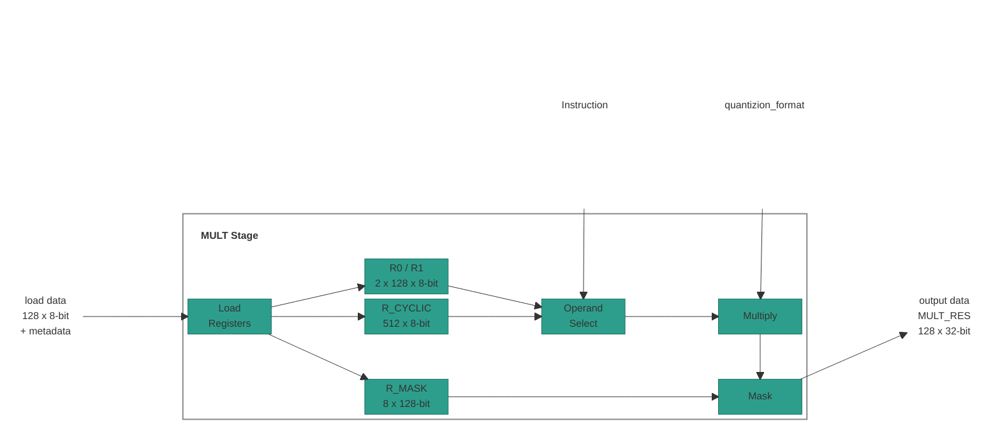
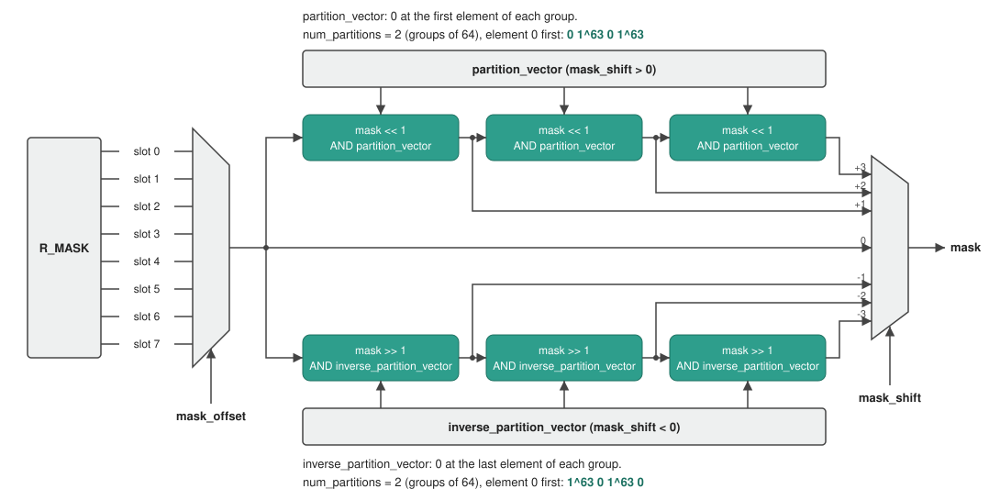

# Multiply Stage

## 1. Overview

The MULT (Multiply) stage performs the following tasks:

- **Dequantize:** Converts each NX8 input element to FP32, with the format
  from `quantizion_format` and the vector scale.
- **Multiply:** Multiplies 128 pairs of FP32 elements. The operands come from
  `R0`/`R1`, `R_CYCLIC` or a scalar. Each product is an FP32 value.
- **Mask:** Replaces the products of masked elements with a pad value. The mask
  comes from `R_MASK`.
- **Load:** Owns the load instructions (`LDR_MULT_REG`, `LDR_CYCLIC_MULT_REG`,
  `LDR_MULT_MASK_REG`). Writes the load data from XMEM into one of the stage
  registers: `R0`, `R1`, one slot of `R_CYCLIC` or `R_MASK`.

## Table of Contents

1. [Overview](#1-overview)
2. [Block Diagram](#2-block-diagram)
3. [Interfaces](#3-interfaces)
    - 3.1 [`dstructure` Layout](#31-dstructure-layout)
    - 3.2 [Element Format](#32-element-format)
        - 3.2.1 [NX8 to FP32](#321-nx8-to-fp32)
    - 3.3 [Operand Addressing](#33-operand-addressing)
    - 3.4 [Element Masking](#34-element-masking)
4. [Multiply ISA](#4-multiply-isa)
    - 4.1 [`NOP`: No Operation](#41-nop-no-operation)
    - 4.2 [`LDR_MULT_REG`: Load R0 or R1](#42-ldr_mult_reg-load-r0-or-r1)
    - 4.3 [`LDR_CYCLIC_MULT_REG`: Load an R_CYCLIC Slot](#43-ldr_cyclic_mult_reg-load-an-r_cyclic-slot)
    - 4.4 [`LDR_MULT_MASK_REG`: Load R_MASK](#44-ldr_mult_mask_reg-load-r_mask)
    - 4.5 [`MULT.RC.VV`: R_CYCLIC Vector x Ra Vector](#45-multrcvv-r_cyclic-vector-x-ra-vector)
    - 4.6 [`MULT.RC.VE`: R_CYCLIC Vector x Scalar](#46-multrcve-r_cyclic-vector-x-scalar)
    - 4.7 [`MULT.RC.VS`: R_CYCLIC Vector Square](#47-multrcvs-r_cyclic-vector-square)
    - 4.8 [`MULT.VE`: Ra Vector x CR Scalar](#48-multve-ra-vector-x-cr-scalar)
    - 4.9 [`MULT.EE`: Ra Element x CR Scalar, Broadcast](#49-multee-ra-element-x-cr-scalar-broadcast)

## 2. Block Diagram



## 3. Interfaces

| Name | Direction | Description |
|------|-----------|-------------|
| XMEM read address | Output | The XMEM row that a load instruction reads: `offset + base`. |
| load data | Input | One XMEM row: 128 8-bit elements (128 B) and the vector metadata (section 3.2.1). |
| Instruction | Input | The operation that the stage does on its registers. |
| `quantizion_format` | Input | The NX8 format of the input elements (section 3.2). |
| output data | Output | `MULT_RES`: 128 FP32 elements, to the ACC stage. |

> **Note:** The stage reads `R0`, `R1`, `R_CYCLIC` and `R_MASK` as they were at
> the start of the cycle. A load into them in the same cycle is visible in the
> next cycle.

### 3.1 `dstructure` Layout

The `cr_idx` operand (`dstructure_cr_idx` in `MULT.VE` and `MULT.EE`) names a
32-bit `CR` that holds the data structure format of the 128-element vector. It
has four 8-bit fields:

| Bits | Field | Description |
|------|-------|-------------|
| `[31:24]` | `N/A` | Not used. |
| `[23:16]` | `valid_partition` | Number of valid groups. The rightmost `num_partition - valid_partition` groups are masked. |
| `[15:8]` | `num_partition` | Number of groups: `1`, `2`, `4` or `8`. `1` means one line of 128 elements, `2` means two lines of 64 elements. |
| `[7:0]` | `valid_elements` | Number of valid elements in a group. |

The stage also reads `pad_mode`, the value written into masked elements
(section 3.4):

| `pad_mode` | Pad value |
|------------|-----------|
| `0` | `0` |
| `1` | `+inf` |
| `2` | `-inf` |

> **TBD:** the bit position of `pad_mode` in the `dstructure` CR.

> **TBD - ask Jacob:** whether `pad_mode` `1` and `2` can be used. They write
> `+inf` and `-inf`, and FP32 elements are never `inf` or `-inf`.

### 3.2 Element Format

Input elements are in the NX8 format. One format applies to all elements. Each
product (`MULT_RES` element) is FP32.

Each MULT instruction (except `NOP`) names the format in its
`quantizion_format` operand, a 32-bit `CR`. It has four 8-bit fields:

| Bits | Field | Description |
|------|-------|-------------|
| `[31:24]` | `N/A` | Not used. |
| `[23:16]` | `sign` | `0` = unsigned, `1` = signed. |
| `[15:8]` | `nx_format` | Exponent format. `0` = dynamic, `1`-`7` = `e1`-`e7` (fixed exponent width `fe`). |
| `[7:0]` | `num_bits` | Total element width `W`: `1`-`8`. `0` is reserved/invalid. |

#### 3.2.1 NX8 to FP32

Every MULT instruction converts each NX8 input element to FP32 before it
multiplies. The conversion uses the element `x` (8 bits), the vector scale `s`
(8-bit `e8m0`) and the exponent width `fe`.

**Exponent width `fe`:**

| `nx_format` | `fe` |
|-------------|------|
| `1`-`7` | The `nx_format` value. |
| `0` (dynamic) | `1` if `dynamic_exponent = 0`, `2` if `dynamic_exponent = 1`. Dynamic elements are signed and 8 bits wide. |

**Fields.** An element is packed from the high end as `{S, Exp, M, 0-pad}`:

```text
fm   = num_bits - fe - sign                // mantissa bits
S    = (sign == 1) ? x[7] : 0
Exp  = x[7 - sign -: fe]                   // fe bits after S
M    = x[7 - sign - fe -: fm]              // fm bits after Exp, 0 when fm = 0
Emax = 2^fe - 1
```

**Value:**

```text
if Exp < Emax:                                            // direct
    fp32 = (-1)^S x 2^(s - 127 - Exp) x (1 + M / 2^fm)
else:                                                     // clamp, Exp = Emax
    fp32 = (-1)^S x 2^(s - 127 - (Emax - 1)) x (M / 2^fm)
```

> **TBD - ask Jacob:** an NX8 element that is `NaN`, `inf` or `-inf`: which FP32
> value does it convert to?

**Vector metadata.** Each vector is loaded and saved with its metadata:

| Metadata | Size | Description |
|----------|------|-------------|
| `Scale` (`s`) | 8 bits | Scale shared by the whole vector. |
| `dynamic_static` | 1 bit | Dynamic or static quantization. |
| `dynamic_exponent` | 1 bit | `e1` or `e2`: the exponent width chosen in dynamic quantization. `0` in static quantization. |

`R0`, `R1` and each 128-element slot of `R_CYCLIC` keep the metadata of the
vector loaded into them. Each element uses the metadata of the register or
slot that holds it.

### 3.3 Operand Addressing

| Operand source | Element `j` | Range of `j` |
|----------------|-------------|--------------|
| `Ra` | `R0[j]` for `j < 128`, `R1[j - 128]` for `j >= 128` | `0`-`255` |
| `R_CYCLIC` | `R_CYCLIC[j]` | `0`-`511` |

A vector operand is 128 consecutive elements from a start index: element `i`
of the operand is `Ra[start + i]` or `R_CYCLIC[start + i]`.

### 3.4 Element Masking

Every multiply instruction masks its result. Bit `i` of a mask belongs to
element `i`. Elements whose mask bit is `1` keep their product; elements whose
bit is `0` get the pad value (`pad_mode`, section 3.1).

The mask is built in two steps:

1. `mask_offset` selects one of the 8 slots of `R_MASK`.
2. `mask_shift` shifts that slot mask by up to 3 elements. After each
   one-element shift, the mask is ANDed with a partition vector, so mask bits
   never cross a group boundary.



```text
shift = clamp(mask_shift, -3, 3)                       // mask_shift is two's complement
mask  = R_MASK.slot[mask_offset]                        // 128 bits
repeat |shift| times:
    if shift > 0: mask = (mask << 1) & partition_vector          // towards higher elements
    if shift < 0: mask = (mask >> 1) & inverse_partition_vector  // towards lower elements

for i in 0..127:
    if mask[i] == 0: MULT_RES[i] = pad_value
```

**Partitions.** The 128 elements form `num_partition` partitions (groups) of
`128 / num_partition` elements (section 3.1). Partition `p` holds elements
`p * (128 / num_partition)` to `(p + 1) * (128 / num_partition) - 1`.

**Partition vectors.** Two 128-bit vectors mark the partition boundaries:

| Vector | Bits that are `0` | Used by |
|--------|-------------------|---------|
| `partition_vector` | The first element of each partition | `mask_shift > 0` |
| `inverse_partition_vector` | The last element of each partition | `mask_shift < 0` |

All other bits are `1`. The vectors for each `num_partition`, element `0` first
(`1^n` is `n` ones):

| `num_partition` | Elements per partition | `partition_vector` | `inverse_partition_vector` |
|-----------------|------------------------|--------------------|----------------------------|
| `1` | `128` | `1^128` | `1^128` |
| `2` | `64` | `0 1^63 0 1^63` | `1^63 0 1^63 0` |
| `4` | `32` | `(0 1^31)` x 4 | `(1^31 0)` x 4 |
| `8` | `16` | `(0 1^15)` x 8 | `(1^15 0)` x 8 |

> **Note:** After reset, every bit of `R_MASK` is `1`: every element keeps its
> product.

> **TBD - ask Aviv:** the default value of `R_MASK`.

> **TBD - ask Aviv:** do we add masking examples?

## 4. Multiply ISA

The MULT and LOAD slots are resolved by CTRL and forwarded down the pipeline. The stage
does not read the CR/LR register files itself (see the Control Stage spec,
section 5).

The opcode enum (`mult_inst_opcode_t`, package `ipu_instr_pkg`) is generated
from [`instruction_spec.py`](../../../src/ipu-isa/src/ipu_isa/instruction_spec.py)
by [`sv_package.py`](../../../src/ipu-gen/src/ipu_gen/sv_package.py).

> **Note:** Each `CR0`-`CR15` and `LR0`-`LR15` register named in the
> instruction operands is **32 bits** wide. An `LR` operand is read after this
> cycle's LR updates.

**Instructions in this section:**

| Instruction | Purpose |
|-------------|---------|
| [`NOP`](#41-nop-no-operation) | Do nothing. |
| [`LDR_MULT_REG`](#42-ldr_mult_reg-load-r0-or-r1) | Load one XMEM row into `R0` or `R1`. |
| [`LDR_CYCLIC_MULT_REG`](#43-ldr_cyclic_mult_reg-load-an-r_cyclic-slot) | Load one XMEM row into one slot of `R_CYCLIC`. |
| [`LDR_MULT_MASK_REG`](#44-ldr_mult_mask_reg-load-r_mask) | Load one XMEM row into `R_MASK`. |
| [`MULT.RC.VV`](#45-multrcvv-r_cyclic-vector-x-ra-vector) | `R_CYCLIC` vector x `R0` or `R1`. |
| [`MULT.RC.VE`](#46-multrcve-r_cyclic-vector-x-scalar) | `R_CYCLIC` vector x a scalar from `Ra` or a `CR`. |
| [`MULT.RC.VS`](#47-multrcvs-r_cyclic-vector-square) | `R_CYCLIC` vector x itself. |
| [`MULT.VE`](#48-multve-ra-vector-x-cr-scalar) | `Ra` vector x a `CR` scalar. |
| [`MULT.EE`](#49-multee-ra-element-x-cr-scalar-broadcast) | One `Ra` element x a `CR` scalar, broadcast to all 128 elements. |

In every `MULT` Operation below, `x` converts both NX8 operands to FP32 (section
3.2.1) and multiplies them. `apply_mask` is section 3.4.

---

### 4.1 `NOP`: No Operation

No operation for the MULT slot.

#### Syntax

```text
NOP
```

#### Operands

None.

#### Example

```text
NOP;;
```

---

### 4.2 `LDR_MULT_REG`: Load R0 or R1

Loads one XMEM row into `R0` or `R1`, with its vector metadata.

#### Syntax

```text
LDR_MULT_REG dest, offset, base
```

#### Operands

| Name | Type | Details |
|------|------|---------|
| `dest` | [`Imm`](../reference/isa/operand-types.md#multstagereg) | `R0` or `R1`. The register that is written. |
| `offset` | [`LrIdx`](../reference/isa/operand-types.md#lridx) | `LR0`-`LR15`. Row offset in XMEM. |
| `base` | [`CrIdx`](../reference/isa/operand-types.md#cridx) | `CR0`-`CR15`. Base row in XMEM. |

#### Operation

```text
dest = XMEM[offset + base]      // 128 elements + metadata (section 3.2.1)
```

#### Example

```text
LDR_MULT_REG R0, LR0, CR0;;
```

---

### 4.3 `LDR_CYCLIC_MULT_REG`: Load an R_CYCLIC Slot

Loads one XMEM row into one 128-element slot of `R_CYCLIC`, with its vector
metadata. The other slots keep their values.

#### Syntax

```text
LDR_CYCLIC_MULT_REG offset, base, index
```

#### Operands

| Name | Type | Details |
|------|------|---------|
| `offset` | [`LrIdx`](../reference/isa/operand-types.md#lridx) | `LR0`-`LR15`. Row offset in XMEM. |
| `base` | [`CrIdx`](../reference/isa/operand-types.md#cridx) | `CR0`-`CR15`. Base row in XMEM. |
| `index` | [`LrIdx`](../reference/isa/operand-types.md#lridx) | `LR0`-`LR15` whose value is `0`, `128`, `256` or `384`. The first element of the written slot. |

#### Operation

```text
R_CYCLIC[index .. index + 127] = XMEM[offset + base]   // 128 elements + metadata (section 3.2.1)
```

#### Example

```text
LDR_CYCLIC_MULT_REG LR0, CR0, LR1;;
```

---

### 4.4 `LDR_MULT_MASK_REG`: Load R_MASK

Loads one XMEM row into `R_MASK` (8 slots of 128 bits, section 3.4).

#### Syntax

```text
LDR_MULT_MASK_REG offset, base
```

#### Operands

| Name | Type | Details |
|------|------|---------|
| `offset` | [`LrIdx`](../reference/isa/operand-types.md#lridx) | `LR0`-`LR15`. Row offset in XMEM. |
| `base` | [`CrIdx`](../reference/isa/operand-types.md#cridx) | `CR0`-`CR15`. Base row in XMEM. |

#### Operation

```text
R_MASK = XMEM[offset + base]    // 128 B = 8 x 128 bits
```

#### Example

```text
LDR_MULT_MASK_REG LR0, CR0;;
```

---

### 4.5 `MULT.RC.VV`: R_CYCLIC Vector x Ra Vector

Multiplies a 128-element window of `R_CYCLIC` by `R0` or `R1`, element by
element.

#### Syntax

```text
MULT.RC.VV rc_idx, ra, mask_offset, mask_shift, cr_idx, quantizion_format
```

#### Operands

The Type column links to the [operand type reference](../reference/isa/operand-types.md).

| Name | Type | Details |
|------|------|---------|
| `rc_idx` | [`LrIdx`](../reference/isa/operand-types.md#lridx) | `LR0`-`LR15`. Start element of the `R_CYCLIC` window (section 3.3). |
| `ra` | [`Imm`](../reference/isa/operand-types.md#multstagereg) | `R0` or `R1`. |
| `mask_offset` | [`Imm`](../reference/isa/operand-types.md#multmaskoffsetimmediate) | `0`-`7`. `R_MASK` slot (section 3.4). |
| `mask_shift` | [`LrIdx`](../reference/isa/operand-types.md#lridx) | `LR0`-`LR15`. Mask shift, `-3`-`+3` (section 3.4). |
| `cr_idx` | [`CrIdx`](../reference/isa/operand-types.md#cridx) | `CR0`-`CR15`. Supplies `num_partition` and `pad_mode` (section 3.1). |
| `quantizion_format` | [`CrIdx`](../reference/isa/operand-types.md#cridx) | `CR0`-`CR15`. Supplies the NX8 format of the input elements (section 3.2). |

#### Operation

```text
for i in 0..127:
    MULT_RES[i] = R_CYCLIC[rc_idx + i] x ra[i]
apply_mask(mask_offset, mask_shift, cr_idx)
```

#### Example

```text
MULT.RC.VV LR0, R0, 0, LR2, CR15, CR14;;
```

---

### 4.6 `MULT.RC.VE`: R_CYCLIC Vector x Scalar

Multiplies a 128-element window of `R_CYCLIC` by one scalar. The scalar is an
element of `Ra` or the low byte of a `CR`.

#### Syntax

```text
MULT.RC.VE rc_idx, src, mask_offset, mask_shift, cr_idx, quantizion_format
```

#### Operands

The Type column links to the [operand type reference](../reference/isa/operand-types.md).

| Name | Type | Details |
|------|------|---------|
| `rc_idx` | [`LrIdx`](../reference/isa/operand-types.md#lridx) | `LR0`-`LR15`. Start element of the `R_CYCLIC` window (section 3.3). |
| `src` | [`LcrIdx`](../reference/isa/operand-types.md#lcridx) | `LR0`-`LR15` or `CR0`-`CR15`. An `LR`'s value selects the scalar `Ra[src]`. A `CR` supplies the scalar in bits `[7:0]`. |
| `mask_offset` | [`Imm`](../reference/isa/operand-types.md#multmaskoffsetimmediate) | `0`-`7`. `R_MASK` slot (section 3.4). |
| `mask_shift` | [`LrIdx`](../reference/isa/operand-types.md#lridx) | `LR0`-`LR15`. Mask shift, `-3`-`+3` (section 3.4). |
| `cr_idx` | [`CrIdx`](../reference/isa/operand-types.md#cridx) | `CR0`-`CR15`. Supplies `num_partition` and `pad_mode` (section 3.1). |
| `quantizion_format` | [`CrIdx`](../reference/isa/operand-types.md#cridx) | `CR0`-`CR15`. Supplies the NX8 format of the input elements (section 3.2). |

#### Operation

```text
scalar = (src is an LR) ? Ra[src] : src[7:0]
for i in 0..127:
    MULT_RES[i] = R_CYCLIC[rc_idx + i] x scalar
apply_mask(mask_offset, mask_shift, cr_idx)
```

#### Example

```text
MULT.RC.VE LR0, LR3, 0, LR2, CR15, CR14;;      // scalar = Ra[LR3]
```

---

### 4.7 `MULT.RC.VS`: R_CYCLIC Vector Square

Multiplies a 128-element window of `R_CYCLIC` by itself, element by element.

#### Syntax

```text
MULT.RC.VS rc_idx, mask_offset, mask_shift, cr_idx, quantizion_format
```

#### Operands

The Type column links to the [operand type reference](../reference/isa/operand-types.md).

| Name | Type | Details |
|------|------|---------|
| `rc_idx` | [`LrIdx`](../reference/isa/operand-types.md#lridx) | `LR0`-`LR15`. Start element of the `R_CYCLIC` window (section 3.3). |
| `mask_offset` | [`Imm`](../reference/isa/operand-types.md#multmaskoffsetimmediate) | `0`-`7`. `R_MASK` slot (section 3.4). |
| `mask_shift` | [`LrIdx`](../reference/isa/operand-types.md#lridx) | `LR0`-`LR15`. Mask shift, `-3`-`+3` (section 3.4). |
| `cr_idx` | [`CrIdx`](../reference/isa/operand-types.md#cridx) | `CR0`-`CR15`. Supplies `num_partition` and `pad_mode` (section 3.1). |
| `quantizion_format` | [`CrIdx`](../reference/isa/operand-types.md#cridx) | `CR0`-`CR15`. Supplies the NX8 format of the input elements (section 3.2). |

#### Operation

```text
for i in 0..127:
    element     = R_CYCLIC[rc_idx + i]
    MULT_RES[i] = element x element
apply_mask(mask_offset, mask_shift, cr_idx)
```

#### Example

```text
MULT.RC.VS LR0, 0, LR2, CR15, CR14;;
```

---

### 4.8 `MULT.VE`: Ra Vector x CR Scalar

Multiplies a 128-element window of `Ra` by the low byte of a `CR`.

#### Syntax

```text
MULT.VE ra_idx, cr_idx, mask_offset, mask_shift, dstructure_cr_idx, quantizion_format
```

#### Operands

The Type column links to the [operand type reference](../reference/isa/operand-types.md).

| Name | Type | Details |
|------|------|---------|
| `ra_idx` | [`LrIdx`](../reference/isa/operand-types.md#lridx) | `LR0`-`LR15`. Start element of the `Ra` window (section 3.3). |
| `cr_idx` | [`CrIdx`](../reference/isa/operand-types.md#cridx) | `CR0`-`CR15`. Supplies the scalar in bits `[7:0]`. |
| `mask_offset` | [`Imm`](../reference/isa/operand-types.md#multmaskoffsetimmediate) | `0`-`7`. `R_MASK` slot (section 3.4). |
| `mask_shift` | [`LrIdx`](../reference/isa/operand-types.md#lridx) | `LR0`-`LR15`. Mask shift, `-3`-`+3` (section 3.4). |
| `dstructure_cr_idx` | [`CrIdx`](../reference/isa/operand-types.md#cridx) | `CR0`-`CR15`. Supplies `num_partition` and `pad_mode` (section 3.1). |
| `quantizion_format` | [`CrIdx`](../reference/isa/operand-types.md#cridx) | `CR0`-`CR15`. Supplies the NX8 format of the input elements (section 3.2). |

#### Operation

```text
for i in 0..127:
    MULT_RES[i] = Ra[ra_idx + i] x cr_idx[7:0]
apply_mask(mask_offset, mask_shift, dstructure_cr_idx)
```

#### Example

```text
MULT.VE LR0, CR3, 0, LR2, CR15, CR14;;
```

---

### 4.9 `MULT.EE`: Ra Element x CR Scalar, Broadcast

Multiplies one element of `Ra` by the low byte of a `CR` and writes the
product to all 128 elements.

#### Syntax

```text
MULT.EE ra_idx, cr_idx, mask_offset, mask_shift, dstructure_cr_idx, quantizion_format
```

#### Operands

The Type column links to the [operand type reference](../reference/isa/operand-types.md).

| Name | Type | Details |
|------|------|---------|
| `ra_idx` | [`LrIdx`](../reference/isa/operand-types.md#lridx) | `LR0`-`LR15`. The `Ra` element, `Ra[ra_idx]` (section 3.3). |
| `cr_idx` | [`CrIdx`](../reference/isa/operand-types.md#cridx) | `CR0`-`CR15`. Supplies the scalar in bits `[7:0]`. |
| `mask_offset` | [`Imm`](../reference/isa/operand-types.md#multmaskoffsetimmediate) | `0`-`7`. `R_MASK` slot (section 3.4). |
| `mask_shift` | [`LrIdx`](../reference/isa/operand-types.md#lridx) | `LR0`-`LR15`. Mask shift, `-3`-`+3` (section 3.4). |
| `dstructure_cr_idx` | [`CrIdx`](../reference/isa/operand-types.md#cridx) | `CR0`-`CR15`. Supplies `num_partition` and `pad_mode` (section 3.1). |
| `quantizion_format` | [`CrIdx`](../reference/isa/operand-types.md#cridx) | `CR0`-`CR15`. Supplies the NX8 format of the input elements (section 3.2). |

#### Operation

```text
product = Ra[ra_idx] x cr_idx[7:0]
for i in 0..127:
    MULT_RES[i] = product
apply_mask(mask_offset, mask_shift, dstructure_cr_idx)
```

#### Example

```text
MULT.EE LR0, CR3, 0, LR2, CR15, CR14;;
```
