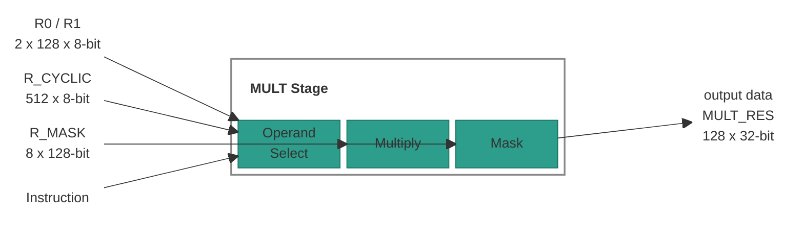
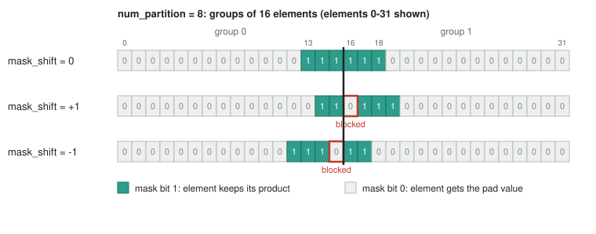

# Multiply Stage

## 1. Overview

The MULT (Multiply) stage performs the following tasks:

- **Multiply:** Multiplies 128 pairs of 8-bit elements. The operands come from
  `R0`/`R1`, `R_CYCLIC` or a scalar. Each product is an FP32 value.
- **Mask:** Replaces the products of masked elements with a pad value. The mask
  comes from `R_MASK`, shifted within element groups.

> **Note:** XMEM loads write the stage's input registers (`R0`, `R1`,
> `R_CYCLIC`, `R_MASK`). The LOAD slot issues the loads.

## Table of Contents

1. [Overview](#1-overview)
2. [Block Diagram](#2-block-diagram)
3. [Interfaces](#3-interfaces)
    - 3.1 [`dstructure` Layout](#31-dstructure-layout)
    - 3.2 [Element Data Types](#32-element-data-types)
    - 3.3 [Operand Addressing](#33-operand-addressing)
    - 3.4 [Element Masking](#34-element-masking)
4. [Multiply ISA](#4-multiply-isa)
    - 4.1 [`NOP`: No Operation](#41-nop-no-operation)
    - 4.2 [`MULT.RC.VV`: R_CYCLIC Vector x Ra Vector](#42-multrcvv-r_cyclic-vector-x-ra-vector)
    - 4.3 [`MULT.RC.VE`: R_CYCLIC Vector x Scalar](#43-multrcve-r_cyclic-vector-x-scalar)
    - 4.4 [`MULT.RC.VS`: R_CYCLIC Vector Square](#44-multrcvs-r_cyclic-vector-square)
    - 4.5 [`MULT.VE`: Ra Vector x CR Scalar](#45-multve-ra-vector-x-cr-scalar)
    - 4.6 [`MULT.EE`: Ra Element x CR Scalar, Broadcast](#46-multee-ra-element-x-cr-scalar-broadcast)

## 2. Block Diagram



## 3. Interfaces

| Name | Direction | Description |
|------|-----------|-------------|
| `R0`, `R1` | Input | Two registers of 128 8-bit elements. Together they form `Ra` (section 3.3). |
| `R_CYCLIC` | Input | A ring of 512 8-bit elements. |
| `R_MASK` | Input | 8 mask slots of 128 bits (section 3.4). |
| Instruction | Input | The operation that the stage does on its input registers. |
| output data | Output | `MULT_RES`: 128 FP32 elements, to the ACC stage. |

> **Note:** The stage reads `R0`, `R1` and `R_CYCLIC` as they were at the start
> of the cycle. A load into them in the same cycle is visible in the next cycle.

> **TBD:** whether a same-cycle load into `R_MASK` is visible to the multiply.
> The emulator makes it visible.

### 3.1 `dstructure` Layout

The `cr_idx` operand (`dstructure_cr_idx` in `MULT.VE` and `MULT.EE`) names a
32-bit `CR` that holds the data structure format of the 128-element vector. It
has four 8-bit fields:

| Bits | Field | Description |
|------|-------|-------------|
| `[31:24]` | `N/A` | Not used. |
| `[23:16]` | `valid_partition` | Number of valid groups. The rightmost `num_partition - valid_partition` groups are masked. |
| `[15:8]` | `num_partition` | Number of groups: `1`, `2`, `4` or `8`. `1` means one line of 128 elements, `2` means two lines of 64 elements. |
| `[7:0]` | `valid_elements` | Number of valid elements in a group. |

The stage also reads `pad_mode`, the value written into masked elements
(section 3.4):

| `pad_mode` | Pad value |
|------------|-----------|
| `0` | `0` |
| `1` | `+inf` |
| `2` | `-inf` |

> **TBD:** the bit position of `pad_mode` in the `dstructure` CR.

> **TBD - ask Jacob:** whether `pad_mode` `1` and `2` can be used. They write
> `+inf` and `-inf`, and FP32 elements are never `inf` or `-inf`.

### 3.2 Element Data Types

Input elements are FP8 `eX`, `X` = `1`-`7`: 1 sign bit, `X` exponent bits and
`7 - X` mantissa bits. One `X` applies to all elements. Each product
(`MULT_RES` element) is FP32.

**FP8 encoding:**

| Rule | Value |
|------|-------|
| Exponent bias | `2^(X-1) - 1` |
| Exponent all ones | NaN |
| Exponent zero | Subnormal |

> **TBD:** which register or configuration selects `X`.

### 3.3 Operand Addressing

| Operand source | Element `j` | Range of `j` |
|----------------|-------------|--------------|
| `Ra` | `R0[j]` for `j < 128`, `R1[j - 128]` for `j >= 128` | `0`-`255`, cyclic: index `j % 256` |
| `R_CYCLIC` | `R_CYCLIC[j]` | `0`-`511`, cyclic: index `j % 512` |

A vector operand is 128 consecutive elements from a start index: element `i`
of the operand is `Ra[(start + i) % 256]` or `R_CYCLIC[(start + i) % 512]`.

### 3.4 Element Masking

Every multiply instruction masks its result. Bit `i` of a mask belongs to
element `i`. Elements whose mask bit is `1` keep their product; elements whose
bit is `0` get the pad value (`pad_mode`, section 3.1).

The mask is built in two steps:

1. `mask_offset` selects one of the 8 slots of `R_MASK`.
2. `mask_shift` shifts that slot mask by up to 3 elements. After each
   one-element shift, the mask is ANDed with a partition vector, so mask bits
   never cross a group boundary.

```text
shift = clamp(mask_shift, -3, 3)                       // mask_shift is two's complement
mask  = R_MASK.slot[mask_offset]                        // 128 bits
repeat |shift| times:
    if shift > 0: mask = (mask << 1) & partition_vector          // towards higher elements
    if shift < 0: mask = (mask >> 1) & inverse_partition_vector  // towards lower elements

for i in 0..127:
    if mask[i] == 0: MULT_RES[i] = pad_value
```

**Partition vectors.** The 128 elements form `num_partition` groups of
`128 / num_partition` elements (section 3.1):

| Vector | Bits that are `0` | Used by |
|--------|-------------------|---------|
| `partition_vector` | The first element of each group | `mask_shift > 0` |
| `inverse_partition_vector` | The last element of each group | `mask_shift < 0` |

All other bits are `1`.

**Example:** `num_partition = 8` (groups of 16). The slot mask has ones at
elements `13`-`18`, which cross the boundary between group 0 and group 1.

| `mask_shift` | Ones at elements | Blocked bit |
|--------------|------------------|-------------|
| `0` | `13`-`18` | |
| `+1` | `14`, `15`, `17`, `18`, `19` | Element 15's bit stops at the boundary: element 16 is `0`. |
| `-1` | `12`, `13`, `14`, `16`, `17` | Element 16's bit stops at the boundary: element 15 is `0`. |



> **Note:** After reset, every bit of `R_MASK` is `1`: every element keeps its
> product.

## 4. Multiply ISA

The MULT slot is resolved by CTRL and forwarded down the pipeline. The stage
does not read the CR/LR register files itself (see the Control Stage spec,
section 5).

The opcode enum (`mult_inst_opcode_t`, package `ipu_instr_pkg`) is generated
from [`instruction_spec.py`](../../../src/tools/ipu-common/src/ipu_common/instruction_spec.py)
by [`gen_codegen.py`](../../../src/tools/ipu-as-py/src/ipu_as/gen_codegen.py).

> **Note:** Each `CR0`-`CR15` and `LR0`-`LR15` register named in the
> instruction operands is **32 bits** wide. An `LR` operand is read after this
> cycle's LR updates.

**Instructions in this section:**

| Instruction | Purpose |
|-------------|---------|
| [`NOP`](#41-nop-no-operation) | Do nothing. |
| [`MULT.RC.VV`](#42-multrcvv-r_cyclic-vector-x-ra-vector) | `R_CYCLIC` vector x `R0` or `R1`. |
| [`MULT.RC.VE`](#43-multrcve-r_cyclic-vector-x-scalar) | `R_CYCLIC` vector x a scalar from `Ra` or a `CR`. |
| [`MULT.RC.VS`](#44-multrcvs-r_cyclic-vector-square) | `R_CYCLIC` vector x itself. |
| [`MULT.VE`](#45-multve-ra-vector-x-cr-scalar) | `Ra` vector x a `CR` scalar. |
| [`MULT.EE`](#46-multee-ra-element-x-cr-scalar-broadcast) | One `Ra` element x a `CR` scalar, broadcast to all 128 elements. |

In every Operation below, `x` is the multiply of section 3.2, and
`apply_mask` is section 3.4.

---

### 4.1 `NOP`: No Operation

No operation for the MULT slot.

#### Syntax

```text
NOP
```

#### Operands

None.

#### Example

```text
NOP;;
```

---

### 4.2 `MULT.RC.VV`: R_CYCLIC Vector x Ra Vector

Multiplies a 128-element window of `R_CYCLIC` by `R0` or `R1`, element by
element.

#### Syntax

```text
MULT.RC.VV rc_idx, ra, mask_offset, mask_shift, cr_idx
```

#### Operands

The Type column links to the [operand type reference](../operand-types.md).

| Name | Type | Details |
|------|------|---------|
| `rc_idx` | [`LrIdx`](../operand-types.md#lridx) | `LR0`-`LR15`. Start element of the `R_CYCLIC` window (section 3.3). |
| `ra` | [`MultStageReg`](../operand-types.md#multstagereg) | `R0` or `R1`. |
| `mask_offset` | [`Imm`](../operand-types.md#multmaskoffsetimmediate) | `0`-`7`. `R_MASK` slot (section 3.4). |
| `mask_shift` | [`LrIdx`](../operand-types.md#lridx) | `LR0`-`LR15`. Mask shift, `-3`-`+3` (section 3.4). |
| `cr_idx` | [`CrIdx`](../operand-types.md#cridx) | `CR0`-`CR15`. Supplies `num_partition` and `pad_mode` (section 3.1). |

#### Operation

```text
for i in 0..127:
    MULT_RES[i] = R_CYCLIC[(rc_idx + i) % 512] x ra[i]
apply_mask(mask_offset, mask_shift, cr_idx)
```

#### Example

```text
MULT.RC.VV LR0, R0, 0, LR2, CR15;;
```

---

### 4.3 `MULT.RC.VE`: R_CYCLIC Vector x Scalar

Multiplies a 128-element window of `R_CYCLIC` by one scalar. The scalar is an
element of `Ra` or the low byte of a `CR`.

#### Syntax

```text
MULT.RC.VE rc_idx, src, mask_offset, mask_shift, cr_idx
```

#### Operands

The Type column links to the [operand type reference](../operand-types.md).

| Name | Type | Details |
|------|------|---------|
| `rc_idx` | [`LrIdx`](../operand-types.md#lridx) | `LR0`-`LR15`. Start element of the `R_CYCLIC` window (section 3.3). |
| `src` | [`LcrIdx`](../operand-types.md#lcridx) | `LR0`-`LR15` or `CR0`-`CR15`. An `LR`'s value selects the scalar `Ra[src % 256]`. A `CR` supplies the scalar in bits `[7:0]`. |
| `mask_offset` | [`Imm`](../operand-types.md#multmaskoffsetimmediate) | `0`-`7`. `R_MASK` slot (section 3.4). |
| `mask_shift` | [`LrIdx`](../operand-types.md#lridx) | `LR0`-`LR15`. Mask shift, `-3`-`+3` (section 3.4). |
| `cr_idx` | [`CrIdx`](../operand-types.md#cridx) | `CR0`-`CR15`. Supplies `num_partition` and `pad_mode` (section 3.1). |

#### Operation

```text
scalar = (src is an LR) ? Ra[src % 256] : src[7:0]
for i in 0..127:
    MULT_RES[i] = R_CYCLIC[(rc_idx + i) % 512] x scalar
apply_mask(mask_offset, mask_shift, cr_idx)
```

#### Example

```text
MULT.RC.VE LR0, LR3, 0, LR2, CR15;;      // scalar = Ra[LR3 % 256]
```

---

### 4.4 `MULT.RC.VS`: R_CYCLIC Vector Square

Multiplies a 128-element window of `R_CYCLIC` by itself, element by element.

#### Syntax

```text
MULT.RC.VS rc_idx, mask_offset, mask_shift, cr_idx
```

#### Operands

The Type column links to the [operand type reference](../operand-types.md).

| Name | Type | Details |
|------|------|---------|
| `rc_idx` | [`LrIdx`](../operand-types.md#lridx) | `LR0`-`LR15`. Start element of the `R_CYCLIC` window (section 3.3). |
| `mask_offset` | [`Imm`](../operand-types.md#multmaskoffsetimmediate) | `0`-`7`. `R_MASK` slot (section 3.4). |
| `mask_shift` | [`LrIdx`](../operand-types.md#lridx) | `LR0`-`LR15`. Mask shift, `-3`-`+3` (section 3.4). |
| `cr_idx` | [`CrIdx`](../operand-types.md#cridx) | `CR0`-`CR15`. Supplies `num_partition` and `pad_mode` (section 3.1). |

#### Operation

```text
for i in 0..127:
    element     = R_CYCLIC[(rc_idx + i) % 512]
    MULT_RES[i] = element x element
apply_mask(mask_offset, mask_shift, cr_idx)
```

#### Example

```text
MULT.RC.VS LR0, 0, LR2, CR15;;
```

---

### 4.5 `MULT.VE`: Ra Vector x CR Scalar

Multiplies a 128-element window of `Ra` by the low byte of a `CR`.

#### Syntax

```text
MULT.VE ra_idx, cr_idx, mask_offset, mask_shift, dstructure_cr_idx
```

#### Operands

The Type column links to the [operand type reference](../operand-types.md).

| Name | Type | Details |
|------|------|---------|
| `ra_idx` | [`LrIdx`](../operand-types.md#lridx) | `LR0`-`LR15`. Start element of the `Ra` window (section 3.3). |
| `cr_idx` | [`CrIdx`](../operand-types.md#cridx) | `CR0`-`CR15`. Supplies the scalar in bits `[7:0]`. |
| `mask_offset` | [`Imm`](../operand-types.md#multmaskoffsetimmediate) | `0`-`7`. `R_MASK` slot (section 3.4). |
| `mask_shift` | [`LrIdx`](../operand-types.md#lridx) | `LR0`-`LR15`. Mask shift, `-3`-`+3` (section 3.4). |
| `dstructure_cr_idx` | [`CrIdx`](../operand-types.md#cridx) | `CR0`-`CR15`. Supplies `num_partition` and `pad_mode` (section 3.1). |

#### Operation

```text
for i in 0..127:
    MULT_RES[i] = Ra[(ra_idx + i) % 256] x cr_idx[7:0]
apply_mask(mask_offset, mask_shift, dstructure_cr_idx)
```

#### Example

```text
MULT.VE LR0, CR3, 0, LR2, CR15;;
```

---

### 4.6 `MULT.EE`: Ra Element x CR Scalar, Broadcast

Multiplies one element of `Ra` by the low byte of a `CR` and writes the
product to all 128 elements.

#### Syntax

```text
MULT.EE ra_idx, cr_idx, mask_offset, mask_shift, dstructure_cr_idx
```

#### Operands

The Type column links to the [operand type reference](../operand-types.md).

| Name | Type | Details |
|------|------|---------|
| `ra_idx` | [`LrIdx`](../operand-types.md#lridx) | `LR0`-`LR15`. The `Ra` element, `Ra[ra_idx % 256]` (section 3.3). |
| `cr_idx` | [`CrIdx`](../operand-types.md#cridx) | `CR0`-`CR15`. Supplies the scalar in bits `[7:0]`. |
| `mask_offset` | [`Imm`](../operand-types.md#multmaskoffsetimmediate) | `0`-`7`. `R_MASK` slot (section 3.4). |
| `mask_shift` | [`LrIdx`](../operand-types.md#lridx) | `LR0`-`LR15`. Mask shift, `-3`-`+3` (section 3.4). |
| `dstructure_cr_idx` | [`CrIdx`](../operand-types.md#cridx) | `CR0`-`CR15`. Supplies `num_partition` and `pad_mode` (section 3.1). |

#### Operation

```text
product = Ra[ra_idx % 256] x cr_idx[7:0]
for i in 0..127:
    MULT_RES[i] = product
apply_mask(mask_offset, mask_shift, dstructure_cr_idx)
```

#### Example

```text
MULT.EE LR0, CR3, 0, LR2, CR15;;
```
