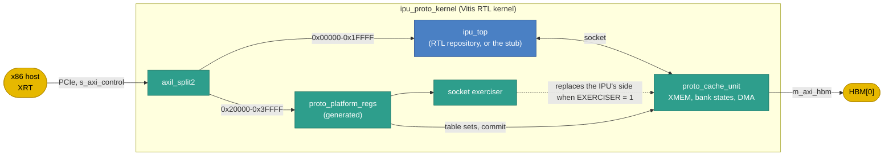
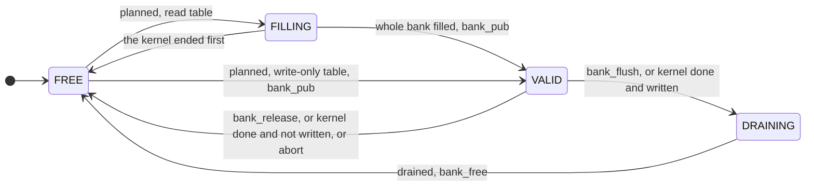

# FPGA prototype on the Alveo U55C

!!! note "Status"
    **Prototype specification.** The decisions are in [ADR 0007](https://github.com/rechefe/ipu-emulator/blob/master/docs/adr/0007-fpga-prototype-on-alveo-u55c.md). A row marked **Default** below is the simplest choice that works: change it here and in the ADR. The files are in [`fpga/alveo-u55c/`](https://github.com/rechefe/ipu-emulator/tree/master/fpga/alveo-u55c) and [`src/ipu-host/`](https://github.com/rechefe/ipu-emulator/tree/master/src/ipu-host).

## Purpose

The prototype runs the IPU RTL on an AMD Alveo U55C, so that kernels and conformance cases run at hardware speed and their results can be compared with the reference model.

This repository holds the platform around the IPU. The IPU itself comes from the RTL repository, as a module `ipu_top` with the ports of [External interfaces](../requirements/interfaces.md). Until that RTL exists, a stub with the same ports stands in.

| In this repository | In the RTL repository |
|---|---|
| The Vitis kernel, the platform registers, the prototype cache unit, the stub | `ipu_top`: CTRL, cache agent, MULT, ACC, AAQ, STORE and the host register block |
| The register maps (SystemRDL) and the register blocks generated from them | Vendored copies of `ipu_instr_pkg.sv`, `ipu_socket_pkg.sv` and the generated `ipu_host` files |
| The host driver, the model of the card, `run_flat` | |

## Decisions

| Item | Value | Status |
|---|---|---|
| Board | Alveo U55C: XCU55C, 16 GB HBM2, PCIe Gen3 x16 | Owner |
| Register maps | SystemRDL in `src/ipu-host/src/ipu_host/rdl/`, generated with PeakRDL | Owner |
| IMEM word stride | 32 bytes; beats 0 to 4 hold the 160-bit padded word, beats 5 to 7 read 0 | Owner. Answers the packing part of OQ-14. |
| First milestones | Platform only: the stub, the cache unit and the host path | Owner |
| Shell | Vitis user-managed RTL kernel on `xilinx_u55c_gen3x16_xdma_3_202210_1`, Vitis 2023.2 | Default |
| Host | The x86 host, through XRT (`xrt::ip`), in the role of the RISC-V host | Default |
| Clock | One clock, `ap_clk`, 100 MHz (IPU-IF-1) | Default |
| Device memory | HBM pseudo-channel 0, through one 512-bit AXI4 master | Default |
| Row address | `{table_id[3:0], offset[19:0]}` in the low 24 bits of `CR[base] + LR[offset]` | Default. The proposal of OQ-8. |
| Element format | A `FORMAT` register per context in the host map | Default. No requirement names how the hardware selects the format: OQ-36. |
| Host-port AXI | Address width 17 bits (the map's), ID width 4 | Default. Part of OQ-15. |
| `tbl_view` | Per table: `enable`, `type`, `format`, `size`, `jump_back`, `repetitions` (60 bits); 16 tables, 2 sets: 1920 bits | Default. Part of OQ-15. |
| Cache unit | Fixed mapping, no page replacement: see [The prototype cache unit](#the-prototype-cache-unit) | Default |
| Abort | The aborted context's banks are freed and none is drained | Default. The proposal of OQ-12. |

## Block diagram

## Shell

The kernel is a user-managed RTL kernel: XRT loads the xclbin but never starts the kernel. The host reads and writes the kernel's AXI4-Lite control port with `xrt::ip`, and allocates device buffers in HBM with `xrt::bo`.

| Kernel port | Kind | Use |
|---|---|---|
| `ap_clk`, `ap_rst_n` | Clock, reset | The one clock. `ap_rst_n` resets everything. |
| `s_axi_control` | AXI4-Lite slave, 18-bit address | The control address map below |
| `m_axi_hbm` | AXI4 master, 512-bit data, 64-bit address | The cache unit's DMA. `v++` connects it to `HBM[0]` (`vitis/connectivity.cfg`). |

`kernel.xml` declares one argument, `hbm`, only so that `v++` accepts the `sp=` connection. Nothing reads it.

### Control address map

| Range | Content | Source |
|---|---|---|
| `0x00000`-`0x07FFF` | IMEM window 0 | `ipu_host.rdl` |
| `0x08000`-`0x0FFFF` | IMEM window 1 | `ipu_host.rdl` |
| `0x10000`-`0x10FFF` | The IPU register file and debug window | `ipu_host.rdl` |
| `0x20000`-`0x21FFF` | The platform: control, cache unit, exerciser, table sets | `proto_platform.rdl` |

Every offset and field is in the `.rdl` files. `bazel run //src/ipu-host:ipu-host -- docs OUT.md` writes them as tables.

### Resets

The platform register `CTRL.IPU_RESET` holds the IPU in reset and `CTRL.CU_RESET` holds the cache unit in reset. Each asserts asynchronously and releases through two flops (IPU-IF-2), so the host resets the IPU without reloading the xclbin.

## The socket

The socket is the port list of [External interfaces](../requirements/interfaces.md), with these prototype choices. `fpga/alveo-u55c/rtl/ipu_socket_pkg.sv` holds the sizes and types; the RTL repository's `ipu_top` imports it.

| ID | Requirement |
|---|---|
| PROTO-SOCK-1 | `ipu_top` shall have the ports of `rtl/ipu_top_stub.sv`, with the names and widths `ipu_socket_pkg` gives. |
| PROTO-SOCK-2 | The host port shall be an AXI4 slave with 32-bit data, an address of `ipu_host_addr_pkg::ADDR_WIDTH` bits and an ID of `HOST_ID_W` bits. The platform sends single beats with ID 0. |
| PROTO-SOCK-3 | `tbl_view` shall be of type `tbl_view_t`: table `t` of set `k` is `tbl_view[k][t]`. |
| PROTO-SOCK-4 | The IPU shall decode its host port with the offsets of `ipu_host.rdl`. |

`ipu_top` may use the generated register block `ipu_host_regs`. PeakRDL regblock 1.3 answers every access with OKAY, so the IPU puts the access rules of [Faults, Illegal host accesses](../requirements/faults.md#illegal-host-accesses) in front of it and answers an illegal access with SLVERR itself (IPU-HOST-5). `ipu_host_addr_pkg` gives the checker every address.

## The IPU host port

[Host registers](../requirements/host-registers.md) lists the register groups. `ipu_host.rdl` places them. Beyond the requirements, the prototype map adds:

| Register | Why |
|---|---|
| `REGS.FORMAT[k]` | The element format of context `k`'s kernel. The emulator takes the format as configuration ([Element formats](../explanation/element-formats.md#selecting-a-format)); the hardware needs it from somewhere (OQ-36). |
| `REGS.ISA_DIGEST` | The first 32 bits of the ISA digest the RTL was built from, so the host refuses a program assembled against another ISA. The SV package does not carry the digest yet (OQ-38). |
| `REGS.KERNEL_CYCLES`, `REGS.RETIRED_WORDS`, `REGS.STALL_CYCLES` | `RETIRED_WORDS` is what the host compares with the reference model's cycle count; the reference model retires one word per cycle and never stalls ([Timing model](../explanation/timing-model.md)). |
| `REGS.PARAMS` | IMEM depth, breakpoints and lanes, for the driver to check. |

An IMEM window holds 1024 words at a 32-byte stride. The driver writes word `i` of a program as five 32-bit beats at `32 * i`: the hardware word, which is the top 155 bits of the emulator word that `ipu-as` writes by default (`ipu_isa.codec.word.hardware_word`).

## The prototype cache unit

The cache unit is outside the IPU ([Requirements, Scope](../requirements/index.md#scope)). The prototype has its own, `rtl/proto_cache_unit.sv`, which meets the `CU-<n>` behaviours the IPU expects with the simplest mapping.

### Mapping

Each table names its banks: page `p` of a table is XMEM bank `FIRST_BANK + p`, for `p` below `SIZE`. A page is never replaced, so a table holds at most its banks and `FIRST_BANK + SIZE` is at most 16. A table whose data is larger than its banks (streaming, with `jump_back` and `repetitions` reusing banks) is a later phase.

### Bank life

At a commit of set `k`, the unit takes a working copy of the set and plans every bank: which (set, table, page) it holds, and whether it is filled from device memory (`read_only`, `read_after_write`, `scratch_pad`) or only claimed (`write_only`). It then acts on each planned bank once the bank is free, the active set first:

Two sets may plan the same bank (flat mode always does). The second set's fill then waits until the first set's kernel is done and the bank is drained, which serialises a handoff between two flat-mode kernels.

| Behaviour | How the prototype meets it |
|---|---|
| CU-1 | Each bank is a URAM with a registered read port: the row arrives the cycle after `ld_valid`. |
| CU-2 | Each bank has its own write port, shared by the IPU's stores (only to VALID banks) and the DMA's fills (only to FILLING banks). |
| CU-3 | `tbl_view` comes from the working copy, which changes only at a commit; a commit of a locked set is refused. |
| CU-4 | Reset frees every bank and clears `tables_valid`. |
| CU-11, CU-12 | A commit raises `tables_valid[k]`; kernel done or abort of `k` clears it. |
| CU-13, CU-14 | A commit is refused (`CU_STATUS.COMMIT_ERR`) while set `k` is locked, still committed, or has banks left. The registers themselves stay writable: they take effect at the next commit. |
| CU-15, CU-16 | The active set's banks go first; the other set's banks fill as soon as they are free. |
| CU-17, CU-18 | At kernel done, written banks drain and the rest free. `CU_STATUS.DRAINED[k]` rises when none of set `k`'s banks is left. |
| CU-20, CU-21 | A bank leaves VALID only on the IPU's events. A fill publishes only the whole bank. |
| CU-22, CU-23 | A `bank_req` for a planned page that is not held plans it again; one for a page filling or valid is ignored. |
| CU-24, CU-25 | `bank_flush` drains then frees with `bank_free`; `bank_release` frees. |
| CU-26 | Tags are `{ctx, table_id, page}`. |
| OQ-11 | Not met: a handed-over table goes through device memory. |

### DMA

One engine, one bank at a time: 32 bursts of 64 beats (4 KiB, the AXI boundary) per bank. Page `p` of a table is at device address `DRAM_LO/HI + p * 128 KiB`, rows in order, 128 bytes each. A fill writes metadata 0, and a drain drops the metadata: the prototype keeps no metadata in device memory (OQ-37). A DMA error response sets `STATUS.DMA_ERR`.

### XMEM

16 banks of 1024 rows of 1040 bits (1024 data, 16 metadata), as `(* ram_style = "ultra" *)` memories: about 15 URAMs per bank, 240 of the U55C's 960.

## Flat mode

Flat mode runs an emulator program unchanged: one `scratch_pad` table, table 0, over all 16 banks (2 MiB). Row `r` of the emulator's XMEM is bank `r >> 10`, row `r & 1023`, because a CR base below 2^20 rows carries table ID 0. `ipu_host.driver.run_flat` loads the program, the CRs and an XMEM image, commits the table, arms, waits, and reads back the image the cache unit drained.

On 2026-10-19, every region base a kernel case writes to a CR is below row 8229, far below 2^20, and every case in a hardware format ends below row 16384, so it fits flat mode.

## Socket exerciser

With `CTRL.EXERCISER` = 1 the platform drives the cache unit's IPU-side ports from its own registers instead of from the IPU: `EX_CMD` pulses one event (load, store, `bank_req`, release, flush, kernel start, done or abort) with the arguments in `EX_ADDR`, `EX_CTX`, `EX_TAG`, `EX_META` and `EX_DATA`. A load lands in `EX_DATA` and `EX_META`. The host thus tests every cache unit behaviour on the card without IPU RTL, and reads or writes XMEM by backdoor.

## The stub

`rtl/ipu_top_stub.sv` is the generated `ipu_host_regs` block with storage behind it: the IMEM windows, the CR banks, `PROG_LEN` and `FORMAT` keep what the host writes. `ARM` from `IDLE`, with the inactive set committed, runs an empty kernel: `active_ctx` flips, `kernel_start` pulses and `kernel_done` follows a cycle later. It executes no word and checks no access rule.

## Host software

The host software is `ipu_host` (`src/ipu-host/`):

| Module | What it does |
|---|---|
| `regmap` | Compiles the `.rdl` files into a lookup map: every register by path, with its address and fields |
| `generate` | The register blocks (`<map>_regs.sv`, `<map>_regs_pkg.sv`), the address packages (`<map>_addr_pkg.sv`) and the docs tables |
| `driver` | `IpuHost` (load a program, CRs, format, commands, status, LR read-out), `Platform` (tables, commit, drained) and `run_flat` |
| `model` | `ModelDevice`: the card, modelled over the reference model |

A `Device` is a 32-bit bus onto the control space plus device memory. `fpga/alveo-u55c/host/xrt_device.py` is the card; `ipu_host.model.ModelDevice` is the model; the same driver code runs on either. `bazel run //fpga/alveo-u55c:run_flat` runs a program on one of them and compares it with the reference model.

### The host-port model

`ModelDevice` follows the register maps and the [execution flow](../requirements/execution-flow.md) as the host sees them, so host software is tested in CI. Its limits:

- A kernel runs to its end inside the `ARM` or `RESUME` write. The host never sees a running state, and the `HALT` command is never accepted.
- Each kernel starts from a reset reference model, so LR and the vector registers do not carry over (IPU-EXEC-5; SW-4 says kernels do not rely on them).
- Tables 0 to 3 map into the emulator's XMEM; bank capacity and streaming are not modelled.
- A PC write, the exerciser, and clearing the enable of F-2 to F-6 answer with an AXI error.

## Verification

| Step | Needs | What it shows | State |
|---|---|---|---|
| `bazel test //src/ipu-host:all` | Bazel | The maps compile, the pinned offsets hold, the generated blocks elaborate, and the driver's flows on the model match direct reference-model runs | Passes |
| `bazel test //fpga/alveo-u55c:all` | Bazel | slang elaborates the kernel with the stub, with no diagnostics in the platform RTL | Passes |
| `fpga/alveo-u55c/sim/run.sh` | Verilator 5 | Host path, IMEM stride, commit, fill, publish, load, store, kernel done, drain to HBM, and the stub's empty kernel | Passes (Verilator 5.020) |
| `make xclbin` | Vitis 2023.2 | Synthesis and implementation at 100 MHz | Not run |

## Milestones

| Milestone | Content | Needs |
|---|---|---|
| M0 | Build the xclbin with the stub; read the IDs; write and read IMEM and CRs on the card | Vitis, a U55C |
| M1 | Drive the cache unit with the exerciser on the card: commit, fill, load, store, done, drain, abort | M0 |
| M2 | Drop in the IPU RTL; run the conformance cases the host can set up (below) and compare with the reference model | IPU RTL |
| M3 | Run kernel cases in flat mode | M2, hardware-format kernels |
| M4 | Streaming tables, handoff without a round trip through device memory, interrupts | Cache unit specification |

### What can run

A conformance case or a kernel case runs on the prototype when it uses a hardware format (INT8, E1 to E7), assembles with `--target hardware`, and fits flat mode. On 2026-10-19:

- **Conformance.** The `insn_*`, `probe_*`, `fault_*` and `arith_*` cases not marked `emulator_only`. Most set LR or vector registers before they run, which the host port cannot write (debug step 0 is read-only): OQ-39.
- **Kernels.** 32 of 481 case-and-format runs use a hardware format. 9 of them also assemble for hardware and fit: the INT8 `proj_p4` family. All 9 use `ACTIVATE.QUANTIZE` and `ST.AAQ`, whose emulator model is a placeholder (OQ-20) and whose store size is open (OQ-35), so their results compare with the reference model only once the AaQ stage is specified. `fully_connected`, `scale`, `residual_add` and `vector_tour` store with the emulator-only `ST.ACC`; `matmul_small` uses `BREAK`.

## Open questions

The prototype raises four questions. They are listed in [Open questions](../requirements/open-questions.md#fpga-prototype):

- OQ-36: how the hardware selects the element format;
- OQ-37: where row metadata lives in device memory;
- OQ-38: how the RTL learns the ISA digest;
- OQ-39: how a test sets LR and vector registers on hardware.
